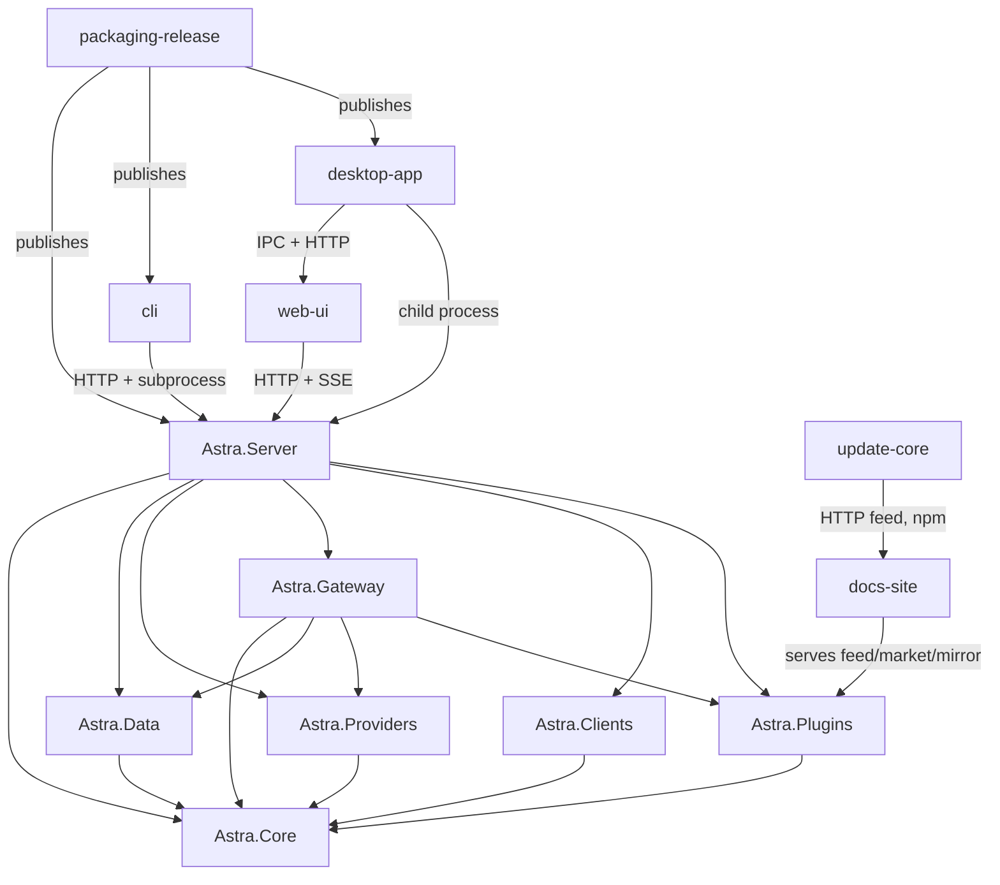

# Architecture

Astra is one product with two toolchains that meet at a build artifact and at HTTP. The .NET side is the runtime;
the pnpm workspace is the surfaces around it (console, CLI, desktop shell, docs/website, packaging).

## Runtimes and processes

| Runtime | What runs there | Started by |
|---|---|---|
| `astra-server` (ASP.NET Core, Native AOT single binary) | Gateway pipeline, admin API, security middleware, alert engine, background workers, plugin hosts | `astra serve`, the desktop app, Docker, autostart |
| Bun sidecar (downloaded, pinned, sha256-verified) | magpie provider plugins (`host.js` / `pi.js`, vendored unmodified) and `bun add` package installs | `astra-server` on demand (`astra-plugins/Runtime`) |
| Jint (in-process, no CLR access) | Plugin gateway middleware and agent plugins | `astra-server` request path |
| Node | `astra` CLI, `docs` Next.js site, vitest suites, tsup/esbuild bundling | the user / CI |
| Electron | Desktop shell: `app://astra` protocol, tray, server child process, update controller | the user |
| Browser | The React console served from `wwwroot` by the server (or from `desktop/renderer`) | the user |

Four consumers of the published server output exist, and each must be kept in step: the `npm/server-*` platform
packages, the desktop installers' `resources/server`, the Docker image (`docker-bin/<arch>`), and the offline updater
in `packages/update-core`. All four must carry the native companion library (`libe_sqlite3.*`) next to the binary.

## Layers and the allowed dependency direction

Set by csproj `ProjectReference` (verified against `src/Astra.*/Astra.*.csproj`):

```
Astra.Core ──┬──> Astra.Data ─────┐
             ├──> Astra.Clients ──┤
             ├──> Astra.Providers ┤
             └──> Astra.Plugins ──┴──> Astra.Gateway ──> Astra.Server
```

- **`Astra.Core` has zero NuGet references** and is the only project every other one may reference. Domain logic
  (billing, pricing, models, privacy, alert contracts, token limits, paths) belongs here; if two siblings need a type,
  it belongs in Core, because siblings cannot reference each other.
- **`Astra.Gateway` does not reference `Astra.Clients`.** Client config take-over is reachable only from
  `Astra.Server`; the gateway sees a client only as `route.Client` / `route.ClientKind` and reads its options as JSON
  (`route.Client.ExtraJson`). This is why a gateway feature that needs client metadata must be fed through the client
  row, not an import.
- **`Astra.Server` is the only composition root.** Everything is wired in `Hosting/AstraApp.cs:AstraApp.Create`:
  DI registrations, middleware order, `Map*Endpoints()` calls, hosted workers. Integration tests reuse the same
  builder through `BuildOptions`.

### Boundaries that must not be crossed

- **Protocol conversion is hub-and-spoke.** All four wire protocols decode into the IR
  (`src/Astra.Gateway/Protocol/Ir.cs`) and re-encode from it; never map one protocol directly to another. Registration
  is only `Protocol/GatewayCodecs.cs:GatewayCodecs.Register`.
- **The HTTP surface is the contract between server, CLI and console.** `web/` is a private package with no library
  entry point and is consumed by the desktop app as `web/dist`, never as a source dependency. A server change the UI
  needs is mirrored in `web/src/api` (hand-written types), never imported.
- **Plugins talk to the host in JSON text and `JsValue` only.** `src/Astra.Plugins/Js/JsRuntime.cs` is the whole
  interop surface; `AllowClr` and CLR wrappers are what would break the AOT build.
- **The magpie-compatible names plugins see are frozen**: `magpie.*` manifest keys, `x-magpie-*` headers,
  `MAGPIE_*_PROXY`.
- **Vanilla Dapper must not be called from a shipped assembly** (see `AGENTS.md` → Native AOT): it roots reflection
  into the AOT closure and fails the publish with an error that points at Dapper, not at the call site.

## Where new code belongs

| New code | Goes in | Also touch |
|---|---|---|
| A business rule (pricing, privacy decision, token budget math) | `src/Astra.Core` | its unit test in `tests/Astra.Core.Tests` |
| A SQL query, a new table or column | `src/Astra.Data` (repository + `Migrations/NNNN_*.sql`) | `tests/Astra.Data.Tests`, never edit an applied migration |
| A wire-protocol mapping | `src/Astra.Gateway/Protocol` (IR + codec) | golden fixtures in `tests/Astra.Gateway.Tests`, the lossy-mapping comments in `Ir.cs` |
| A pipeline stage or upstream behaviour | `src/Astra.Gateway/Pipeline` | a span in `TraceSpanNames` plus the web `SPAN` map and `TraceRepository`, if it should be visible ([request-tracing](flows/request-tracing.md)) |
| An admin endpoint | `src/Astra.Server/Api/*Endpoints.cs` + `Map*Endpoints` in `AstraApp.Create` | `web/src/api/types.ts` + `hooks.ts`, zh/en i18n, `Api/ServerJsonContext.cs` |
| A provider family or quota probe | `src/Astra.Providers` | the quota worker's due-check, the console's card, the alert descriptor |
| A local client adapter | `src/Astra.Clients/Adapters` | `ClientKinds.All`, `ClientAdapterRegistry.BuiltIn`, docs client list, the console's option group |
| A plugin capability | `src/Astra.Plugins` | the contracts in `src/Astra.Core/Plugins`, the server's plugin endpoints |
| A background job | `src/Astra.Server/Hosting/*Worker.cs` | registration + `BackgroundService` in `AstraApp.Create`, an explicit initial delay |
| A console screen | `web/src/pages` + `web/src/api/hooks.ts` | both i18n catalogs |
| A documentation page | `docs/content/docs/<module>/` + that folder's `meta.json` | the root `meta.json` when it is a new module |
| A CLI command | `cli/src/commands` | `cli/src/index.ts` wiring, the command map in `docs/content/docs/cli/index.mdx` |
| A change to a client adapter, the applier or an editor | `src/Astra.Clients` **and** `packages/client-config` | the golden cases `tests/fixtures/client-config/**` (linked update 20), [connect](modules/connect.md) |
| A packaging or release step | `.github/workflows/*.yml`, `scripts/*.mjs` | the linked-update list in the root AGENTS.md |

## Verified module graph



Every arrow above is a real reference: the C# edges are csproj `ProjectReference` entries; the cross-toolchain edges
are HTTP routes, child processes, IPC channels or the published feed, as recorded in each module page.

## Failure handling by layer

- `Astra.Core` throws domain exceptions; it never writes HTTP.
- `Astra.Gateway` renders failures in the **inbound protocol's** error shape through
  `GatewayPipeline.WriteErrorAsync`; the gateway's client-facing messages are Chinese.
- `Astra.Server` renders admin failures as JSON `{ error }`, either from `AdminApiException` through
  `Api/AdminApiErrorFilter.cs` or from the older `Results.NotFound/BadRequest(new ErrorOnlyDto(...))` style — both are
  in use, so match the group being edited.
- The console renders whatever arrives and falls back to `HTTP <status>` when the body is not the expected shape; a
  security-middleware denial never reaches the error filter at all.
- Background workers catch their own exceptions and log: a failing round must not kill the loop.
