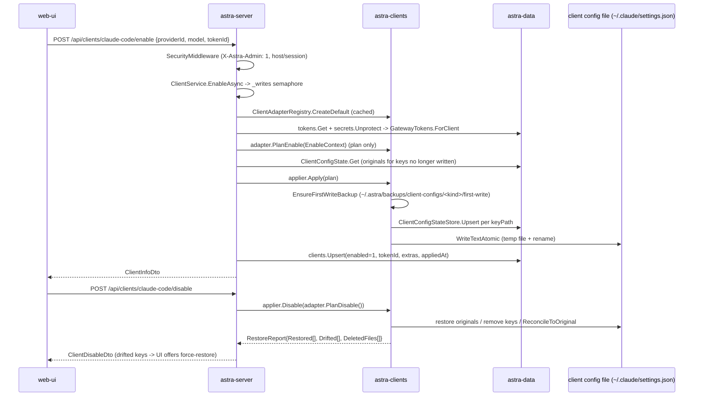

# Client config take-over (enable / disable / restore)

**Trigger:** the user clicks *Enable…* (then *Enable*) or *Disable & restore* on a client card in the web Clients
page (`web/src/pages/ClientsPage.tsx:374`) — or runs `astra restore-all [--purge]` offline.
**Outcome:** the client's own config file (e.g. `~/.claude/settings.json`, `~/.next-cowork/providers.json`)
points at the Astra gateway with that client's local key; `clients.enabled = 1`,
`client_config_state` holds one row per written keyPath with its original and applied value, and
`~/.astra/backups/client-configs/<kind>/first-write/` holds a permanent copy of each file as it was before
Astra's first write. Disabling puts the recorded originals back key by key, skips keys the user edited
(drift), deletes files Astra created that are empty again, and clears `clients.enabled`.

## Steps
1. `web/src/pages/ClientsPage.tsx:374` — `ClientPanel` renders *Enable…* (`clients.enable`) or *Disable & restore*
   (`clients.disableRestore`); enabling opens `EnableSheet`, which fires
   `usePreviewEnable` → `useEnableClient`/`useDisableClient` (`web/src/api/hooks.ts:886`–`902`) (`web-ui`)
2. ⇢ crosses process boundary via HTTP: `api()` (`web/src/api/client.ts`) → `POST /api/clients/{kind}/preview-enable`
   | `/enable` (body `{providerId, model?, extras?, tokenId?}`) | `/disable` | `/force-restore`; every non-GET carries
   the `X-Astra-Admin: 1` header and cookies (`web-ui` → `astra-server`)
3. `src/Astra.Server/Security/Security.cs:121` — `SecurityMiddleware` requires `X-Astra-Admin: 1` on mutating `/api`
   calls (403 otherwise), enforces the loopback Host allowlist at :94, and a session when not loopback (:129). It
   never inspects the body (`astra-server`)
4. `src/Astra.Server/Api/ClientEndpoints.cs:31` — `MapClientEndpoints` routes to `ClientService.EnableAsync` /
   `DisableAsync(kind, force: false|true)`; the group carries `AdminApiErrorFilter`, which turns
   `AdminApiException` into JSON `{ error }` (`astra-server`)
5. `src/Astra.Server/Api/ClientService.cs:545` — every mutating method takes the `_writes` `SemaphoreSlim`, so two UI
   requests can never interleave two config writes (`astra-server`)
6. `ClientService.RefreshRegistryAsync` (`:511`) → `IAgentPluginCatalog.RefreshAsync`, then
   `src/Astra.Clients/Adapters/ClientAdapterRegistry.cs:18` `CreateDefault(env, db.ClientConfigState, agents,
   remembered)`: the 26 built-ins (`:30`) plus `PluginClientAdapter`s, cached in a `volatile` field keyed by
   (plugin generation, remembered plugin ids) (`astra-clients`, `astra-plugins`)
7. `ClientService.PrepareAsync` (`:286`) — resolves the adapter and asserts `Availability == Available` (409
   otherwise), loads/creates the `clients` row, requires an enabled provider, validates `extras.options` through
   `ClientOptions.Validate` (`19d9778`), requires the token (`record.TokenId` ?? `TokenIds.Default`) and derives the
   key `GatewayTokens.ForClient(secrets.Unprotect(token.KeyEnc), kind)` (`astra-server`, `astra-core`)
8. `ClientService.ContextAsync` (`:325`) → `EnableContext { GatewayBaseUrl, LocalKey, Model, Extras }`
   (`src/Astra.Clients/Config/EnableContext.cs:8`), where `GatewayBaseUrl` is `ServerOptions.GatewayBaseUrl` —
   i.e. `ASTRA_PUBLIC_URL` when set, else the actually-running origin from `runtime.json`, never the configured
   port (`astra-server`, `astra-core`)
9. `IClientAdapter.PlanEnable` (`src/Astra.Clients/Config/IClientAdapter.cs:27`) — each adapter *plans* only, never
   writes. E.g. `ClaudeCodeClientAdapter.cs:50` plans `env.ANTHROPIC_BASE_URL`, `env.ANTHROPIC_AUTH_TOKEN` (plus
   model slots and the `ANTHROPIC_API_KEY` *removal*); `NextCoWorkClientAdapter.cs:45` plans the whole
   `providers.astra` object as one `ConfigChangeKind.Table`-style owned value. `ClientAdapterBase.BuildPlan`
   (`:48`) simulates the edits through `ConfigEditorOps` to produce per-file unified diffs (`astra-clients`)
10. `ClientService.EnablePlan` (`:363`) — reserved for the UI path: on enable, re-adds the *original* values of keys
   Astra is about to stop writing (cleared model, unset `ClientOptions.ConfigKeyPaths`, Claude Code tiers) by
   reading `db.ClientConfigState`, so one `Apply` also restores them (`astra-server`, `astra-data`)
11. `ClientConfigApplier.Preview` (`src/Astra.Clients/Config/ClientConfigApplier.cs:35`) — the same simulation with
   **no** file, backup or state writes; the sheet renders `changes` + `diffs` and nothing is committed until the
   user confirms (`astra-clients`)
12. `ClientConfigApplier.Apply` (`:50`) — per file: `EnsureFirstWriteBackup` (`:423`, kept forever, written once per
    path), build `ConfigEditorOps` over the current text, apply each change, `UpsertState` (`:501` — on a *new* row
    records `OriginalAbsent`/`OriginalValueJson` from the pre-write read, always overwrites `AppliedValueJson`),
    `CreateRollingBackupDir` + `AddRollingBackup` (`:439`, pruned to `MaxRollingBackups = 20`, `first-write`
    excluded), then `ClientEnvironment.WriteTextAtomic` (`ClientEnvironment.cs:109`, temp file + rename, BOM
    preserved) (`astra-clients`)
13. `ClientConfigStateStore.Upsert` (`src/Astra.Data/Repositories/ClientConfigStateStore.cs:39`) — Dapper.AOT upsert
    into `client_config_state (client_kind, file_path, key_path, original_absent, original_value_json,
    applied_value_json, applied_at)`, UNIQUE on the first three (`src/Astra.Data/Migrations/0001_init.sql:123`);
    the store is reached through `IClientConfigStateStore` (`src/Astra.Core/Clients/ClientContracts.cs:143`) so
    adapters can read originals while planning (`astra-data`, `astra-core`)
14. `ClientService.EnableAsync` (`:171`) then commits metadata: `record.Enabled = true`, `TokenId`,
    `SelectedModel`, `ExtraJson` (= `context.Extras`), `AppliedAt = UtcNow`; `db.Clients.UpsertAsync(record,
    CancellationToken.None)` deliberately ignores cancellation once files are on disk; the chosen provider is moved
    to binding priority 0 (`astra-server`, `astra-data`)
15. `ClientService.InfoAsync` (`:402`) — returns the `ClientInfoDto`; `adapter.Inspect()` +
    `ClientAdapterBase.BuildStatus` (`:92`) compare each state row's `AppliedValueJson` with the file
    (`ConfigValueCodec.EqualsValue`) to report `enabled` / `drifted` / `configOutdated` (`astra-clients`)
16. Back in the UI, `useClientMutation` (`web/src/api/hooks.ts:856`) invalidates `clients`, `providers`,
    `provider` and `client-models` queries, so the card flips to *Enabled* with an `appliedAt` stamp, or the
    `drifted` badge and warnings appear (`web-ui`)
17. **Disable (same path in reverse):** `ClientService.DisableAsync` (`:192`) plans `adapter.PlanDisable()` and runs
    `ClientConfigApplier.Disable` → `Restore` (`:109`, `force: false`) or, on user confirmation,
    `/force-restore` → `ForceRestore` (`:92`, `force: true`). Per key: no state row → `NotTracked`; file gone but
    originally absent → state row deleted; current value ≠ `AppliedValueJson` (or a Table key that is no longer
    set) → `Drifted`, left untouched; otherwise the original is decoded with `ConfigValueCodec.DecodeToSource` and
    spliced back, or removed when `OriginalAbsent`, followed by `PruneEmptyParents` using the first-write copy. A
    file Astra created that is now contentless is deleted; a clean restore calls `ReconcileToOriginal` (`:265`) to
    put the byte-identical first-write backup back. `client_config_state` rows are deleted per restored key and
    `clients.enabled = 0` (`astra-clients`, `astra-server`, `astra-data`)
18. `POST /api/clients/{kind}/backups/{id}/restore` (`ClientEndpoints.cs:40`) is the separate escape hatch:
    `ClientService.RestoreBackupAsync` (`:217`) validates the id against `ListBackups` (never a filesystem path),
    calls `RestoreFromBackup` (`:379`) and re-derives `enabled` from `Inspect()` (`astra-server`, `astra-clients`)
19. **Offline counterpart:** `astra restore-all [--purge]` → `cli/src/index.ts:263` → `runRestoreAll`
    (`cli/src/commands/restore-all.ts:8`) → `resolveServerBinary()` (`cli/src/lib/binary.ts`) and
    `spawn(binary, ['restore-all', '--purge'?])` with `stdio: 'inherit'`; also used by
    `cli/src/commands/uninstall.ts:14` (there a failure only warns) (`cli`)
20. ⇢ crosses process boundary via a child process + exit code, not HTTP: `Commands.RestoreAllAsync`
    (`src/Astra.Server/Program.cs:41` dispatch → `src/Astra.Server/Commands.cs:21`) opens the DB itself
    (`AstraDatabase.InitializeAsync(paths, importSeed: false)`), rebuilds plugin adapters *without running plugin
    code* from `JsonObject["plugin"]` in `clients.extra_json` (descriptors written by `ClientService.ContextAsync`),
    then loops `applier.Disable(PlanPurge() or PlanDisable())` + `clients.enabled = false`. Drifted keys are left and
    reported on stderr; any drift makes the exit code 1 (`astra-server`, `cli`)
21. **Repair (strict JSON):** a client that reads its config with a strict parser lists those files in
    `ClientAdapterBase.StrictJsonFiles` (`src/Astra.Clients/Config/ClientAdapterBase.cs:ClientAdapterBase.StrictJsonFiles`;
    `ClaudeDesktopClientAdapter` is the one that does). `FindRepairs` runs `StrictJson.FindProblem`
    (`src/Astra.Clients/Editing/StrictJson.cs:StrictJson`) and the status card carries them as `ConfigRepair`
    (`src/Astra.Clients/Config/ClientStatus.cs:ConfigRepair`). The console shows the warning and posts
    `POST /api/clients/{kind}/repair` (`ClientEndpoints.cs`) → `ClientService.RepairAsync` →
    `ClientConfigApplier.Repair`, which strips comments and trailing commas only, takes the same first-write and
    rolling backups, and records **no** key state. Files that are missing, already strict, or not JSONC at all are
    left alone. `ReconcileToOriginal` then refuses to byte-restore an original that was not strict, because those
    bytes are what the client could not read (`astra-clients`, `astra-server`, `web-ui`)
22. Other automatic rewrites that reuse this machinery, all guarded by `!enabled || drifted ⇒ skip`: the
    *reapply* banner (`web/src/components/layout/ConnectionBanner.tsx:69` → `POST /api/clients/reapply` →
    `ClientService.ReapplyOutdatedAsync`, `:461`, fed by `OutdatedPlanAsync`, `:437`), token rotation/reset
    (`TokenService.cs:138`/`:155` and `TokenMigrationWorker.cs:38` → `RewriteForTokenAsync`, `:238`), and provider
    model changes (`ProviderEndpoints.cs:568` → `SyncModelListsAsync`, `:122`)

## Sequence

## Errors and cancellation
- `AdminApiException(status, message)` from `ClientService` (`404` unknown kind / provider / token, `409` client
  unsupported / token disabled / no key yet, `400` choose-a-provider / invalid extras options) is rendered as
  `{ error }` by `Api/AdminApiErrorFilter.cs`; the UI shows it via `toast(errorText(e), 'error')`.
- File-level failures inside adapters/applier are `EditorException`, `IOException`, `UnauthorizedAccessException`
  and `CryptographicException`. `EnableAsync`/`PreviewAsync` do **not** catch them (they surface as a 500 / error
  toast); `OutdatedPlanAsync`, `SyncModelListCoreAsync` and the per-client loop in `RewriteForTokenAsync` swallow
  exactly that set and report the client as skipped, so one unreadable client never fails a batch rewrite.
- Restore-level drift is not an exception: it is a `RestoredKey` with `RestoreKeyOutcome.Drifted`.
  `DisableAsync` returns `ClientDisableDto.Drifted` and the page asks for confirmation before `/force-restore`
  (`ClientsPage.tsx:328`); `restore-all` prints `  Left modified key untouched: <file>:<key>` on stderr and exits 1.
- Cancellation: `ClientService.MutateAsync` (`:545`) waits on `_writes` with the request's `ct`. Once a plan has
  been applied, the metadata commit deliberately uses `CancellationToken.None` (`EnableAsync:184`,
  `SyncModelListCoreAsync:152`, `ReapplyOutdatedAsync:482`, `RewriteForTokenAsync:262`) so a closed tab cannot
  leave files written but no `clients` row. A disconnect during `applier.Apply` itself can leave a partially
  written plan — the recoveries are *Reapply* (idempotent `PlanEnable`), the backups sheet, and `restore-all`.
- `restore-all` is a child process: `runRestoreAll` throws `AstraError` on a non-zero exit (`uninstall.ts:37`
  only warns); its exit code is 1 iff any key drifted or any adapter threw.

## Where to hook in
- **New client:** add the kind to `ClientKinds.All` (`src/Astra.Core/Clients/ClientContracts.cs`), its entry to
  `ClientInstallCatalog.All`, an `IClientAdapter` deriving from `ClientAdapterBase`, and one line in
  `ClientAdapterRegistry.BuiltIn` (`:30`) — the registry order is `ClientKinds.All` order, and the catalog order is
  pinned by `tests/Astra.Clients.Tests/ClientInstallTests.cs:85`. Also `ClientService.NameOf` (`:554`), the web icon map `web/src/components/icons.tsx`
  and zh/en i18n keys.
- **New client-specific option:** one `ClientOptionDescriptor` in `Astra.Core/Clients/ClientOptions.cs`, its
  consumer (adapter for scope `config`; gateway for scope `gateway`, read through `route.Client.ExtraJson`), its
  key path in `ClientOptions.ConfigKeyPaths` so unsetting/disabling restores it, plus zh/en
  `clients.option.<key>[.hint]` — the panel renders itself from the descriptors on `ClientInfoDto.Options`.
- **A client that can use more than one protocol:** list them in `ClientProtocols.For` (`Astra.Core/Clients/ClientProtocols.cs`,
  default first) and have the adapter write each model with `ClientAdapterBase.ModelProtocols(ctx, default)` — per model when
  the client allows it (NextCoWork `protocolOverride`, Pi/omp `api`, OpenCode `provider.npm`, VS Code `apiType` …), else one
  provider per protocol (`astra-responses`, `astra-anthropic`, created only while they have models; Crush, Copilot CLI,
  MiniMax Code, DeepSeek Harness, Paseo). The `protocols` hint comes from `GatewayRouter.PassthroughProtocols` in
  `ClientService.ContextAsync`; the user's choices are `extras.protocolOverrides`, and a client whose own UI can change
  them implements `IClientProtocolChoices` so the server records those changes. Removing a key Astra added (a provider no
  longer needed) in `Apply` restores its absence and prunes the empty containers, like a restore.
- **A client that rewrites Astra's entry in normal use** (NextCoWork normalises the aliases it lists): override
  `ClientAdapterBase.ValueStillOurs` to compare only the parts Astra owns, pass the same comparison on the plan's
  `ConfigChange.StillOurs`, and carry the client's own fields over when rewriting.
- **New config format:** a `ConfigEditorOps.Create` arm (`src/Astra.Clients/Config/ConfigEditorOps.cs:26`), a
  `ConfigFileFormat` value, and a `ClientAdapterBase.FormatOfPath` branch (`:81`) — precedent: `ShellBlock`
  (+`ShellBlockEditor`) in `628e692`. `ConfigValueCodec` decides the JSON-vs-raw encoding per format, and
  `IsJsonValued` controls whether empty parents can be pruned.
- **A client that parses strict JSON:** override `ClientAdapterBase.StrictJsonFiles` and nothing else — the status
  card, the repair endpoint and the restore guard all hang off that list. Repairing through anything but
  `ClientConfigApplier.Repair` skips the backups, and a later restore will put the unreadable original back.
- **Tempting but wrong:** never write a client config through `File.*` directly or from an adapter — go through
  `ClientConfigApplier` (plan → `Apply`/`Disable`), or `client_config_state`, the first-write copy and drift
  detection silently stop matching. Do not call `SqlMapper.AsList`/`ToList` in shipped code (Dapper.AOT; the store
  uses the `List<T>` constructor on purpose), do not edit an already-applied migration when adding a column, and do
  not "fix" a drifted file by deleting its `client_config_state` row — that loses the original the user needs.

## Related
- Modules: [astra-clients](../modules/astra-clients.md), [astra-server](../modules/astra-server.md),
  [astra-data](../modules/astra-data.md), [astra-core](../modules/astra-core.md), [web-ui](../modules/web-ui.md),
  [cli](../modules/cli.md)
- Also touched: [astra-gateway](../modules/astra-gateway.md) (`/v1` + the `cacheTtl` gateway-side option),
  [astra-plugins](../modules/astra-plugins.md) (plugin clients and the remembered descriptors)
- Git-history cross-check: `628e692` added the NextCoWork (`NextCoWorkClientAdapter.cs:45`, `providers.astra` in
  `~/.next-cowork/providers.json`) and Muse Code adapters, the `ShellBlock` format, and only a doc-comment update in
  `ClientAdapterBase`/`ClientService.NameOf` — the drift/backup rules themselves were untouched. `19d9778` added
  per-client options: `EnableContext.ModelsWithoutContext1M`, `ClientOptions.Validate` in `ClientService.PrepareAsync`,
  `ClientOptions.ConfigKeyPaths` in `EnablePlan` and `ClientInfoDto.Options`. `git log -S` puts
  `MaxRollingBackups` / `EnsureFirstWriteBackup` / `ReconcileToOriginal` / `PruneEmptyParents` in the initial commit
  `4682a52`, and later `65d4393` ("token limits, alert webhooks, key page, and Paseo client") introduced the
  `IsClientManagedKey` escape hatch in `ClientAdapterBase.BuildStatus` (`:103`).
