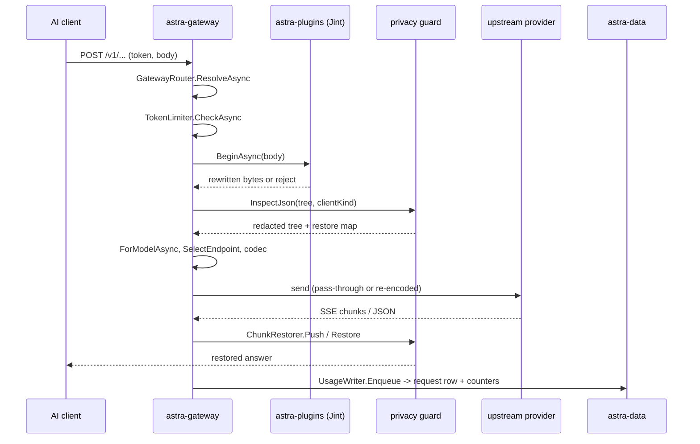

# Gateway request

**Trigger:** an AI client posts a generation request to the gateway (`/v1/chat/completions`, `/v1/responses`,
`/v1/messages`, `/v1beta/models/<model>:generateContent|streamGenerateContent`).
**Outcome:** the client got the upstream's answer (streamed or buffered) in its own protocol, with privacy redactions
restored, and a request row, its span tree and usage counters were queued for persistence.

## Steps

1. `src/Astra.Gateway/Http/GatewayEndpoints.cs:MapGatewayEndpoints` — route asked for the inbound `ApiProtocol` and
   calls `GatewayPipeline.HandleAsync`; `/v1beta` path variants pass the model, `stream` and `?alt=sse` from the URL.
2. `src/Astra.Gateway/Pipeline/GatewayPipeline.cs:GatewayPipeline.HandleAsync` — opens the request record (ULID,
   `StartedAtUtc`, `Remote` from `RequestOrigin.IsRemote`, client IP), sets `x-astra-request-id`, and publishes it to
   `Pipeline/LiveRequestFeed.cs:LiveRequestFeed.Start` so the console shows it immediately.
3. `Pipeline/GatewayRouter.cs:GatewayRouter.ResolveAsync` — resolves the bearer token/key into a `GatewayRoute`
   (token, client kind, provider). A request marked remote always needs a token even when
   `RequireGatewayKey=false`; that switch only opens the gateway to this machine (`Pipeline/GatewayRouter.cs`). A bare
   token with a provider pool (`tokens.pool_json`, `Core/Tokens/TokenPool.cs`, issue #2) gets a route whose `Targets`
   are its usable members and whose `Pool` is set; `<token>.<kind>` calls never use the pool.
4. `Pipeline/TokenLimiter.cs:TokenLimiter.CheckAsync` — token budgets and the RPM window are checked once, before
   anything leaves the machine; a refusal throws `GatewayException` (`permission_error` / `rate_limit_error`).
5. `Pipeline/RequestBody.cs:RequestBody.ReadAsync` — the body is read once into a pooled UTF-8 buffer; everything
   after this reads that buffer or one JSON tree over it.
6. ⇢ in-process call into `astra-plugins`: `Pipeline/GatewayPipeline.cs:GatewayPipeline.HandleAsync` calls
   `MiddlewareEngine.BeginAsync` (`src/Astra.Plugins/Middleware/MiddlewareEngine.cs`) with the agent's own body.
   A hook may rewrite the bytes or reject; a rewrite is `RequestBody.Replace`, a reply is wrapped by
   `Plugins/MiddlewareResponseStream.cs:MiddlewareResponseStream.Install`. The reject is thrown in the agent's own
   error shape (`Plugins/GatewayMiddleware.cs:GatewayMiddleware.Rejected`).
7. `Pipeline/PrivacyGuardService.cs:PrivacyGuardService.InspectJson` (or `Inspect` for a non-object body) — runs
   after the middleware and before anything is sent. A `block` action throws; redactions are written into the parsed
   tree in place and the placeholder→original map becomes `RestoreMap`.
8. `Pipeline/RequestReasoning.cs:RequestReasoning.Capture` — log-only metadata (reasoning effort etc.), read before
   any codec derives upstream budgets from it. Never touches the wire.
9. `Pipeline/GatewayRouter.cs:GatewayRouter.ForModelAsync` — a client bound to several providers gets the first one
   serving this model (as an enabled model or through its mapping), else its primary. A pool route instead gets an
   ordered candidate list from `Pipeline/PoolRouting.cs:PoolRouting.PlanAsync` (members serving the model, minus those
   `ProviderHealth` cools or without a usable account, ordered by `ProviderPoolScheduler` with sticky sessions).
   `SubscriptionSupport.EnforceClientPolicy` (`Pipeline/UpstreamAuthResolver.cs`) rejects before capability discovery
   can send anything.
10. `Pipeline/EffectiveModelResolver.cs` + `IModelProtocolResolver` — the upstream model and the protocols the
    provider actually supports are resolved (capability discovery may hit the network).
11. `Pipeline/GatewayRouter.cs:GatewayRouter.SelectEndpoint` + `Protocol/GatewayCodecs.cs:GatewayCodecs.Register` —
    the upstream protocol is chosen per model; `passthrough = upstreamProtocol == inbound`. With passthrough the
    client's own bytes (or the middleware's rewrite) go upstream; otherwise `IProtocolCodec.DecodeRequest` builds the
    IR (`Protocol/Ir.cs`) and the upstream codec re-encodes it. Missing codec → 501.
12. Same-host rewrites while the body tree is still ours: model mapping, `stream_options.include_usage` injection for
    OpenAI Chat streaming, the `force_stream` Responses shape, and the Claude Code mimicry / Relay `cache_control`
    TTL. Every stage that mutates the tree must set `upstreamDirty`, or the client's original bytes go upstream.
13. ⇢ network: `Pipeline/GatewayPipeline.cs:GatewayPipeline.SendAsync` sends through `Pipeline/AccountScheduler.cs`
    (`StickyKeys` picks the account; a `Lease` holds the in-flight slot in balanced mode), `UpstreamAuthResolver`
    supplies credentials, and `Pipeline/Upstream.cs:GatewayHttpClients` performs the call. That handler deliberately
    disables `ActivityHeadersPropagator` so the agent's `traceparent` never leaks to the provider. Steps 10–12 run in
    `HandleAsync`'s local `PrepareAsync`, once per candidate: a pool request whose attempt fails before anything reached
    the client (`Pipeline/ProviderFailover.cs` classifies the status / exception) is prepared again for the next member
    and resent (`astra.attempt.retry = provider_failover`); the client's guarded tree is cloned, never rewritten, while
    another attempt may follow. Every route reports its outcome to `ProviderHealth`.
14. Response side: `Protocol/Ir.cs` decode (or passthrough), `Pipeline/PrivacyGuardService.cs:ChunkRestorer`
    restores placeholders (streaming: `Pipeline/GatewayPipeline.cs:StreamAsync`; buffered: `BufferAsync`;
    forced-stream-when-client-wanted-JSON: `CollapseStreamAsync`), `Pipeline/RequestBilling.cs` prices the usage, and
    an upstream failure goes through `ForwardErrorAsync` — rendered in the **inbound** protocol's error shape.
15. `finally`: `Finish` builds the record (status, tokens, cost, protocol, passthrough), `FinishTrace` writes its
    spans, `usageWriter.Enqueue(record)` hands it to `Pipeline/UsageWriter.cs`, which batch-writes through
    `RequestRepository` in the same transaction that accumulates `token_usage_totals` / `token_usage_daily`, then
    tells `TokenUsageLedger.Persisted`. `LiveRequestFeed.Finish` closes the live row.
16. ⇢ HTTP: the console reads the same rows back via `src/Astra.Server/Api/RequestEndpoints.cs`; the live view stays
    on the SSE feed.

## Sequence

## Errors and cancellation

- `GatewayException` is rendered by `GatewayPipeline.WriteErrorAsync` in the inbound protocol's shape and sets the
  record's `ErrorType`; a token refusal additionally sets `RecordErrorType = TokenLimits.RefusedErrorType`
  (`"token_limit"`) so such a row is not counted against the budget again (`TokenLimits.Counts`).
- `ProtocolException` is a client-body problem (400). `UpstreamIdleTimeoutException` → 504, `HttpRequestException` → 502,
  anything else → 500; all of them still write a record.
- Client disconnect: `OperationCanceledException` when `RequestAborted` fired sets `ClientCancelled`, cancels the
  upstream call with it, and still bills the usage seen so far — unless the end of the answer (finish or error event)
  was already written (`ResponseObserver.Delivered`): agents leave on `[DONE]` / `response.completed` while the ChatGPT
  backend keeps its stream open, and that request succeeded (or is the upstream error it delivered).
- Streaming holds the response open; `MiddlewareResponseStream.CompleteAsync` runs in `finally` so a plugin's held
  reply is flushed even on the error paths (its IO failures are swallowed).

## Where to hook in

- **Supported:** a gateway middleware plugin (the magpie `onRequest` / `onEvent` / `onResponse` contract) — it sees
  the agent's body first and its output is still subject to the privacy guard.
- **Supported:** a new wire protocol is one `IProtocolCodec` plus a `GatewayCodecs.Register` entry and golden fixtures;
  a new lossy mapping belongs in `Protocol/Ir.cs`'s comments and in `ir.Warnings`.
- **Looks tempting but breaks:** rewriting the request tree without setting `upstreamDirty` silently ships the
  client's original bytes; managing the `AccountScheduler.Lease` by hand double-disposes it (`SendAsync` already
  disposes on its throwing path); a new capability probe placed before `EnforceClientPolicy` sends a request the
  client policy forbids.

## Related
- Modules: [astra-gateway](../modules/astra-gateway.md), [astra-core](../modules/astra-core.md),
  [astra-data](../modules/astra-data.md), [astra-providers](../modules/astra-providers.md),
  [astra-plugins](../modules/astra-plugins.md), [astra-server](../modules/astra-server.md)
- [request-tracing](request-tracing.md), [privacy-redaction](privacy-redaction.md),
  [token-limits-enforcement](token-limits-enforcement.md), [plugin-install-and-run](plugin-install-and-run.md),
  [admin-api-request](admin-api-request.md)
