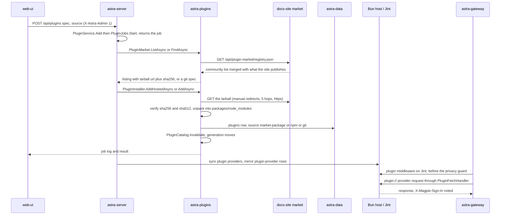

# Plugin install and run

**Trigger:** the user installs a magpie-compatible plugin — *Install* on the web Plugins page's *Market* tab
(`web/src/pages/PluginsPage.tsx:518`), a `?install=<spec>` link from the site (`:545`), or `astra plugin add <spec>`
(`cli/src/commands/plugin.ts:115`) — where the spec is a market package, a `github:owner/repo`, any other git spec, a
path, or a bare npm name.
**Outcome:** the package is on disk under `~/.astra/plugins/` (`packages/node_modules/<name>`, or a
`market-packages/<name>/<version>.tgz` kept beside it), one row exists in SQLite `plugins` (its source naming where it
came from), and the catalog's generation has moved — so the plugin's code runs from then on: middleware in process on
Jint before the privacy guard of every agent request, an agent as the `plugin-<id>` client kind on the Clients page, a
provider through the Bun host as `plugin-<id>` provider rows with `plugin://` endpoints.

## Steps

### (a) Install

1. `web/src/pages/PluginsPage.tsx:518` `MarketTab` — lists `usePluginMarket` and searches `usePluginSearch`
   (`web/src/api/hooks.ts:1181`, `:1186`); `install()` (`:531`) confirms first (`plugins.trustDetail`) and sends a
   `source` derived from the result: `github`, `market` (astra) or `npm` (`:590`). The `?install=` deep link is
   gated by `LINK_SPEC` (`:36`) so only a package name or `github:owner/repo` can be asked for that way (`web-ui`)
2. ⇢ crosses **process** boundary via HTTP: `POST /api/plugins` `{spec, source}` with `X-Astra-Admin: 1`
   (`web/src/api/client.ts`) — the CLI uses the same route (or `POST /api/plugins/update`) (`web-ui`/`cli` →
   `astra-server`)
3. `src/Astra.Server/Api/PluginEndpoints.cs:17` — `MapPluginEndpoints` dispatches to `PluginService.Add`
   (`src/Astra.Server/Api/PluginService.cs:80`), which starts a job and answers the job at once:
   `PluginJobs.Start` (`src/Astra.Plugins/Packages/PluginJobs.cs:17`) runs the work on `Task.Run` with
   `CancellationToken.None` (`:26`), so a client that hangs up does not abort an install; the page follows
   `GET /api/plugins/jobs/{id}` (`PluginEndpoints.cs:22`, `hooks.ts:1140`) (`astra-server`,`astra-plugins`)
4. `src/Astra.Server/Api/PluginService.cs:87` — a plain package name (not a path/git spec) is looked up in the market
   first (`FindListingAsync` `:124`): `minAstraVersion` is enforced at `:92`, a hosted tarball → `AddHostedAsync`
   (`:98`), a listing carrying a git `spec` → `AddAsync(gitSpec, ...)` (`:100`); anything else, or a market that cannot
   be reached, falls through to npm (`:104`) (`astra-server`)
5. `src/Astra.Plugins/Market/PluginMarket.cs:173` `RegistryAsync` — the registry is read at most every 6 h (`:49`),
   over a 6 s timeout (`:187`), written to `~/.astra/plugins/market/registry.json` (`:56`, `:192`) and otherwise served
   from that cached copy and finally from the built-in `Astra.Plugins.Market.market.json` (`:207`, `:273`). `Source`
   (`:62`) is `ASTRA_PLUGIN_MARKET` > the `PluginMarketUrl` setting > `DefaultUrl`
   `https://astra-gate.si/api/plugin-market/registry.json` (`:47`) (`astra-plugins`)
6. ⇢ crosses **network** boundary via HTTPS `GET /api/plugin-market/registry.json` (no auth) — the docs site's route
   `docs/app/api/plugin-market/registry.json/route.ts` → `buildRegistry` (`docs/lib/plugin-market/registry.ts:46`),
   which merges the one fixed community registry (`loadUpstream`,
   `docs/lib/plugin-market/upstream.ts:160`) with the entries+packs published on the site, and answers ETag/304
   (`astra-plugins` → `docs-site`)
7. `docs/lib/plugin-market/upstream.ts:18` — `UPSTREAM` is a single hard-coded address
   (`https://raw.githubusercontent.com/astragate-community/astra-gate-plugins/main/registry.json`); commit `6abd354`
   deleted the `PLUGIN_MARKET_UPSTREAM` override and added the `source` field to the cached `upstream.json`
   (`:23`–`:28`, checked at `:118`, `:126`) so a list cached from a former upstream is never served as this one's.
   When upstream is unreachable the shipped snapshot `docs/lib/plugin-market/upstream-fallback.json` stands in
   (`:153`); that file is byte-identical to the server's
   `src/Astra.Plugins/Market/market.json` and the two move together (AGENTS.md linked update 10) (`docs-site`)
8. `docs/lib/plugin-market/store.ts` — market storage under `${DATA_DIR}/plugin-market/` (`entries.json`, `packages/`,
   `upstream.json`), tarball paths validated against `packages/` (`packageFile`), publishing gated by
   `PLUGIN_UPLOAD_TOKEN` (`verifyPublishToken`) (`docs-site`)
9. `src/Astra.Plugins/Market/PluginMarket.cs:139` `SearchAsync` — the registry's search is derived from its address
   (`SearchUrl` `:160` requires the path to end in `/registry.json`), so search goes through the site too
   (`docs/app/api/plugin-market/search/route.ts` → `docs/lib/plugin-market/search.ts`, npm + GitHub's
   `topic:magpie-plugin`); a market with no search beside it searches nothing (`:143`) (`astra-plugins` → `docs-site`)
10. `src/Astra.Plugins/Packages/PluginInstaller.cs:49` `AddCoreAsync` — one `_lock` serialises installs; the spec is
    classified by `PluginSpec` (`IsPath`/`IsGit`/`IsPackageName`, `src/Astra.Plugins/Store/PluginSpec.cs:13`, `:22`,
    `:25`); the target is `PluginSpec.Target` (`:45`, the path itself or `packages/node_modules/<name>`); the manifest
    is read from it (`PackageManifest.Read`, `src/Astra.Plugins/Packages/PackageManifest.cs:68`) and a package naming
    nothing to load throws `NotPluginReason` and is removed again if it was installed just now (`:94`–`:99`); a git
    spec bun did not list in the packages `package.json` is an error, not a silent success (`:77`) (`astra-plugins`)
11. `src/Astra.Plugins/Packages/PluginInstaller.cs:215` `InstallNpmAsync` — a package that runs only in process
    (middleware or agent and no `main`/`exports`: `PackageManifest.InProcessOnly`, `PackageManifest.cs:53`) is
    unpacked straight from npm's tarball with no Bun at all (`:225`, `NpmTarballFetcher.InstallAsync` `:45`); anything
    else is `bun add --ignore-scripts <name>@<resolved version>` (`:245`) — the exact version, never a tag, because
    Bun resolves tags by its own config (`:243`) (`astra-plugins`)
12. `src/Astra.Plugins/Packages/PluginInstaller.cs:256` `InstallHostedAsync` — the market's tarball is fetched by
    `NpmTarballFetcher.DownloadVerifiedAsync` (`src/Astra.Plugins/Packages/NpmTarballFetcher.cs:71`), checked against
    the registry's sha256 (always) and sha512 (when listed) (`:96`–`:99`), then unpacked and kept at
    `~/.astra/plugins/market-packages/<name>/<version>.tgz` with the packages `package.json` pointing at it
    (`RecordDependency` `:407`) (`astra-plugins`)
13. ⇢ crosses **network** boundary via HTTPS: `src/Astra.Plugins/Packages/NpmTarballFetcher.cs:116`
    `GetFollowingRedirectsAsync` follows redirects by hand — commit `b91acca` added this because a GitHub Release
    asset always redirects to its storage host: at most `MaxRedirects = 5` hops (`:109`, `:124`), each hop must be
    `https` or `http` on loopback (`:126`), and the download is hashed whichever host it came from (`:96`). The
    address and the hash come **only** from the registry (`PluginService.cs:94`); the shared clients never follow a
    redirect themselves (`src/Astra.Core/SystemProxy.cs:61` sets `AllowAutoRedirect = false`) (`astra-plugins`)
14. `src/Astra.Plugins/Packages/NpmTarballFetcher.cs:180` `Unpack` — regular files and directories only (links
    skipped, `:189`), every path must stay inside the package folder (`:198`), 50 MiB packed / 200 MiB unpacked
    (`:17`–`:18`); `ExtractAsync` (`:138`) unpacks into `<dest>.part` and moves it over the destination so nothing of
    an older version is left beside the new one (`astra-plugins`)
15. `src/Astra.Plugins/Runtime/BunRuntime.cs:65` `EnsureAsync` — `ASTRA_BUN` if set, else the pinned
    `BunRuntime.Version` 1.4.2 (`:17`) downloaded to `~/.astra/plugins/runtime/bun-<version>/` with its own
    https-only ≤ 5-hop follower (`GetFollowingAsync` `:92`) and a SHA-256 check against `Sums` (`:19`, `:147`);
    `.part` + `File.Move` (`:157`–`:164`) (`astra-plugins`)
16. `src/Astra.Plugins/Packages/PluginInstaller.cs:103` — the entry (spec, package name, source, installed version)
    is saved through `PluginCatalog.Store`; re-adding the same plugin keeps its options and enabled flag
    (`:110`–`:120`). `IPluginListStore` (`src/Astra.Core/Plugins/PluginContracts.cs:65`) is implemented by
    `PluginRepository` (`src/Astra.Data/Repositories/PluginRepository.cs:10`) over the `plugins` and
    `plugin_provider_prefs` tables (`src/Astra.Data/Migrations/0012_plugins.sql:12`, `:25`) (`astra-data`)
17. `src/Astra.Plugins/Packages/PluginInstaller.cs:126` — the `finally` calls `PluginCatalog.Invalidate`
    (`src/Astra.Plugins/PluginCatalog.cs:63`), which bumps the generation and raises `Changed` (`:24`); everything
    that must react keys off that: the middleware set and the agent catalog re-read on a stamp that also includes each
    module file's mtime+size (`MiddlewareEngine.cs:83`, `AgentPluginCatalog.cs:92`), the plugin host restarts, and
    `PluginProviderWorker.OnPluginsChanged` (`src/Astra.Server/Api/PluginProviderSync.cs:258`) wakes a provider sync
    (`astra-plugins` → `astra-server`)
18. `src/Astra.Server/Api/PluginProviderSync.cs:30` `SyncAsync` — each provider the host lists becomes a row
    `plugin-<id>` (`RowId` `:27`) with `AuthScheme.Plugin`, `AdapterId = plugin:<id>` and one `plugin://` endpoint per
    wire API (`:90`–`:96`, `PluginFetchHandler.BaseFor`); its models and accounts are mirrored (`:117`, `:156`,
    `extra.plugin_key` names the sign-in in `plugin-auth.json`); a provider whose plugin is gone is switched off, not
    deleted (`:51`–`:57`) (`astra-server` → `astra-data`)
19. `src/Astra.Server/Api/PluginSignInService.cs:39` — signing in to a plugin's provider: the host's methods
    (`:44`), prompt (`:50`), validate (`:57`), `authorize` + `callback` for a browser flow (`:68`, `:103`), a key
    (`:115`), sign-out (`:130`) and usage (`:140`). The host writes `~/.astra/plugins/plugin-auth.json`
    (`PluginHost.cs:146`, `host.js:654`) — plaintext by OpenCode's format, never returned by the API; accounts are
    mirrored into SQLite at `:156`–`:181`, and `/api/plugin-providers/{id}` (`PluginEndpoints.cs:40`) is the surface
    (`astra-server` → `astra-plugins`)
20. `src/Astra.Plugins/Runtime/HostAssets.cs:20` `Ensure` — the embedded `host.js`/`pi.js` are written to
    `~/.astra/plugins/host/<sha256[..12]>/` (never overwritten while a running host may be reading them); the vendored
    pair is recorded in `src/Astra.Plugins/Host/VENDORED.md:12` and checked by `HostAssetsTests`
    (`astra-plugins`)

### (b) Run

21. **Middleware** — `src/Astra.Gateway/Pipeline/GatewayPipeline.cs:143` calls `MiddlewareEngine.BeginAsync`
    (`src/Astra.Plugins/Middleware/MiddlewareEngine.cs:32`), which returns `null` when no enabled plugin has a
    middleware module, so a plugin-free gateway pays nothing (`:34`); `GatewayMiddleware.Info`
    (`src/Astra.Gateway/Plugins/GatewayMiddleware.cs:27`) builds the ctx info (protocol/model/stream/path/agent) and
    the run executes at `GatewayPipeline.cs:151` — **before** the privacy guard, on agent requests only (`astra-gateway`)
22. `src/Astra.Plugins/Middleware/MiddlewareEngine.cs:96` `Load` → `MiddlewareModule.Load`
    (`src/Astra.Plugins/Middleware/MiddlewareModule.cs:47`) evaluates the module once per plugin and requires at least
    one of `onRequest`/`onEvent`/`onResponse`; a module that throws is recorded per spec and shown on the plugins page
    (`MiddlewareEngine.cs:108`) (`astra-plugins`)
23. `src/Astra.Plugins/Js/JsRuntime.cs:19` — one Jint engine per module, with the deadline constraint
    (`DeadlineConstraint`, `:207`), `LimitRecursion(512)`, `LimitMemory(256 MiB)`, a 200 ms regex timeout and
    `console` as the only global (`:31`–`:50`); host interop is JSON text and `JsValue` only, with no `AllowClr` — that
    is what keeps the assembly AOT-safe (`:12`) (`astra-plugins`)
24. `src/Astra.Plugins/Js/JsModuleLoader.cs:37` `Resolve` — imports must be `./`/`../` and stay inside the plugin
    root, symlinks resolved out of it too (`:48`, `:53`); a package must be bundled into the module (`:49`). Hook
    limits: `onRequest`/`onResponse` 250 ms, `onEvent` 50 ms, load 1 s (`MiddlewareEngine.cs:19`, `:22`, `:25`); a
    hook that throws or times out leaves its input as it was (`MiddlewareEngine.cs:246`–`:279`) (`astra-plugins`)
25. `src/Astra.Plugins/Middleware/MiddlewareEngine.cs:165` `Request` — each `onRequest` in list order, what one
    returns is what the next is given; `ctx.reject(status, message)` (`:299`) becomes `GatewayMiddleware.Rejected`
    (`src/Astra.Gateway/Plugins/GatewayMiddleware.cs:34`) → `GatewayException`, rendered in the agent's own error shape
    (`astra-plugins` → `astra-gateway`)
26. `src/Astra.Gateway/Plugins/MiddlewareResponseStream.cs:44` `Install` — when a middleware wants events or a whole
    reply, the response body feature is replaced so `onEvent` sees one complete SSE event (`SseEventFramer.TrySplit`,
    `MiddlewareEngine.cs:189`) and `onResponse` sees a whole JSON reply with `ctx.status` (`:209`); a `null` from
    `onEvent` drops the event, a `null` from `onResponse` is an error (`:216`) (`astra-gateway`)
27. **Agent** — `src/Astra.Plugins/Agents/AgentPluginCatalog.cs:43` `RefreshAsync` loads every enabled plugin's
    `magpie.agent` module on Jint (checked by `Check` `:148`: id, config file, model, format, MCP format; an id that is
    a built-in client kind or `astra` is refused `:117`); `ClientAdapterRegistry.CreateDefault`
    (`src/Astra.Clients/Adapters/ClientAdapterRegistry.cs:18`) adds one `PluginClientAdapter` per loaded agent; the
    kind is `ClientKinds.PluginPrefix + agent.Id` — i.e. `plugin-<id>` (`src/Astra.Clients/Adapters/PluginClientAdapter.cs:25`,
    `ClientKinds.PluginPrefix` `src/Astra.Core/Clients/ClientContracts.cs:53`) (`astra-plugins` → `astra-clients`)
28. `src/Astra.Clients/Adapters/PluginClientAdapter.cs:63` `PlanEnable` — Astra renders the file, its model key and the
    gateway URL/key, then the plugin's `connect` returns the other keys (`AgentPluginCatalog.Connect` `:66`); all
    writes still go through `ClientConfigApplier`, so the client-config-takeover invariants hold. `RequireWritable`
    (`:204`) refuses to let a plugin take over anything outside the user's home or inside `.ssh`/`.astra`/shell
    startup files (`astra-clients`)
29. `src/Astra.Server/Api/ClientService.cs:328` — enabling a plugin client writes the whole `AgentPluginDescriptor`
    into `clients.extra_json` under `plugin`; `Commands.RestoreAllAsync` (`src/Astra.Server/Commands.cs:21`)
    re-deserialises those descriptors and rebuilds the adapters **without running any plugin code**
    (`ClientAdapterRegistry.cs:23`: `agents` null, so `PlanDisable` comes from the recorded state alone), which is what
    makes `astra restore-all` work offline and after the plugin is gone (`astra-server` → `astra-clients`)
30. **Provider** — `src/Astra.Plugins/Host/PluginHost.cs:121` `StartAsync` starts one Bun child for all host plugins:
    `PluginHostClient.Start` (`src/Astra.Plugins/Host/PluginHostClient.cs:72`) runs `bun run host.js` (the vendored
    magpie host) with newline-delimited JSON on stdin/stdout, and the `init` call (`PluginHost.cs:144`) carries
    `authPath`, `modelsDevPath`, `piPath`, `directory`, `prefer` and `plugins[{spec,target,options}]`. `GetAsync`
    (`:91`) restarts the host when the catalog generation moved or the proxy did (`:192`) and retires the old one
    (`:202`) (`astra-plugins`)
31. `src/Astra.Plugins/Runtime/ChildEnvironment.cs:22` `Build` — Astra's environment minus every `ASTRA_*` variable
    (a container's `ASTRA_ADMIN_PASSWORD` must never reach plugin code) and with the proxy as `MAGPIE_*_PROXY` (`:39`)
    because Bun reads `*_PROXY` once and would then put even a "direct" provider through it (`astra-plugins`)
32. ⇢ crosses **process** boundary via stdin/stdout JSON-RPC — methods `init`, `providers`, `prompt`, `validate`,
    `authorize`, `callback`, `apiKey`, `load`, `usage`, `checkin`, `check`, `import`, `take`, `signOut`, `reload`,
    plus the `fetch` stream and `credit`/`abort` (`PluginHostClient.CallAsync` `:113`, `PluginHost.cs:54`); unsolicited
    events are `auth`, `signIn`, `log`, `toast`, `recovered` (`PluginHost.OnEvent` `:209`). The protocol is bounded
    (64 KiB frames, 512 KiB credit window, `PluginHostClient.cs:33`) (`astra-plugins`)
33. `src/Astra.Plugins/Host/PluginFetchHandler.cs:46` `SendAsync` — a `plugin://<provider>/…` request is resolved to
    the provider's account-scoped loader base URL (`PluginProviders.LoaderBaseAsync` `:101`), the model id the vendor
    knows it by, the AI SDK package's wire API (`PluginProviders.ProtocolOf` `:129`), and the sign-in the plugin adds;
    Astra's own `authorization`/`x-api-key` headers are dropped (`:99`), `X-Magpie-Conversation` becomes the plugin's
    session and `X-Magpie-Sign-In` is taken off the reply and fed to `PluginProviderSync.NoteSignInAsync`
    (`PluginProviderSync.cs:69`) (`astra-plugins`)
34. `src/Astra.Gateway/Pipeline/GatewayPipeline.cs:49` — the gateway holds one `HttpClient` over `PluginFetchHandler`
    and uses it for a plugin provider (`:590`) instead of the network client, so a provider plugin's request never
    leaves the machine except through its own plugin; the account's `plugin_key` and proxy ride as request options
    (`:734`–`:736`) (`astra-gateway`)
35. **Diagnostics** — `astra-server plugin-selftest` (`PluginSelfTest.Run`,
    `src/Astra.Plugins/Diagnostics/PluginSelfTest.cs:23`) writes throwaway middleware/agent plugins and exercises
    Jint, imports, rejects and events on each published AOT binary, because AOT can break at run time what the JIT
    never showed (`astra-plugins`)

## Sequence

## Errors and cancellation
- Install failures are not HTTP failures: `PluginJobs.Start` catches everything, appends the message to the log and
  marks the job `failed` (`src/Astra.Plugins/Packages/PluginJobs.cs:29`); the page renders the log and the error
  (`PluginsPage.tsx:510`), the CLI throws `AstraError` (`cli/src/commands/plugin.ts:80`). Job logs keep at most 400
  lines (`PluginJobs.cs:12`).
- Only the parts before the job starts are `AdminApiException`: an empty spec (`PluginService.cs:83`, 400) and
  `ASTRA_PLUGINS=off` (`:148`, 409). `AdminApiErrorFilter` renders both as `{ error }`.
- Download and unpack failures throw `InvalidDataException`/`HttpRequestException` and delete what they wrote
  (`NpmTarballFetcher.cs:101`–`:105`); a hosted tarball is deleted again unless its version installed
  (`PluginInstaller.cs:294`–`:299`); a package that names nothing to load is removed after install
  (`PluginInstaller.cs:94`); a checksum or tarball-identity mismatch is a hard error, never a warning
  (`NpmTarballFetcher.cs:96`, `PluginInstaller.cs:269`–`:272`).
- `bun add`/`bun update` failures carry Bun's last six lines and a 5-minute timeout that kills the process tree
  (`PluginInstaller.cs:377`–`:395`); Bun's `minimumReleaseAge` is explained rather than passed through
  (`:392`). `UpdateAsync` collects per-plugin errors and throws one combined error at the end (`:180`–`:187`).
- A middleware hook that throws, returns a non-object or runs past its limit leaves the input exactly as it was and
  counts as a failure — it never fails the request (`MiddlewareEngine.cs:246`–`:279`); only an explicit
  `ctx.reject` does, and that surfaces as the agent's own error shape (`GatewayMiddleware.cs:34`).
- Starting or calling the plugin host wraps anything but cancellation in `PluginHostException`
  (`PluginHost.cs:108`, `:111`), which the sign-in service maps to 502 (`PluginSignInService.cs:189`) and
  `PluginFetchHandler` maps to `HttpRequestException` (`PluginFetchHandler.cs:113`). `SyncAsync` logs a warning and
  changes nothing when the host cannot be reached (`PluginProviderSync.cs:44`–`:47`).
- `PluginJobs.Start` deliberately passes `CancellationToken.None` to the job body (`PluginJobs.cs:26`): a closed tab
  never half-installs. Cancellation only reaches the install where the caller threaded its own token into
  `HttpClient` calls.

## Where to hook in
- **A new plugin kind**: a `magpie.*` key in `PackageManifest.ReadFolder` (`PackageManifest.cs:116`), its chip in
  `InstalledPlugin.Kinds` (`PluginCatalog.cs:94`), the constant in `PluginKinds`
  (`src/Astra.Core/Plugins/PluginContracts.cs:46`) and a loader. A manifest field without a `Kinds` entry means the
  plugin shows no chip; without a loader it installs and never runs.
- **A new marketplace field**: `MarketListing` + `ToListing`/`ToTarball` (`src/Astra.Plugins/Market/PluginMarket.cs:20`,
  `:234`), `web/src/api/types.ts`, `cli/src/commands/plugin.ts`, `docs/lib/plugin-market/types.ts` and
  `docs/content/docs/advanced/plugin-market.mdx` — one contract across five files (AGENTS.md linked update 10).
- **A new host RPC**: call it through `PluginHost.CallAsync` and add it to the vendored `host.js` by re-vendoring
  (`node scripts/vendor-magpie-host.mjs <commit>`, then read the diff) — never hand-editing `host.js`/`pi.js`, and
  updating `VENDORED.md` with it (`Host/VENDORED.md:9`).
- **A new sign-in shape**: `PluginSignInService` + `/api/plugin-providers/{id}/*` (`PluginEndpoints.cs:40`) + web
  hooks; the credential itself must stay in `plugin-auth.json` and reach SQLite only as `extra.plugin_key`.
- **Tempting but wrong**: taking the tarball URL or hash from the caller (`PluginService.cs:94` is the only source);
  pointing the market at another registry by hand (commit `6abd354` removed that override on purpose, and the cached
  `upstream.json` is rejected unless its `source` matches); hand-editing the vendored `host.js`/`pi.js` (re-vendor
  instead, and refresh `VENDORED.md` with it); letting a plugin's descriptor out of `clients.extra_json` (that
  snapshot is what `restore-all` needs);
  and calling `SqlMapper.*` in shipped code (Dapper.AOT, see the module map).

## Related
- Modules: [astra-plugins](../modules/astra-plugins.md), [astra-server](../modules/astra-server.md),
  [astra-gateway](../modules/astra-gateway.md), [astra-clients](../modules/astra-clients.md),
  [astra-data](../modules/astra-data.md), [astra-core](../modules/astra-core.md), [web-ui](../modules/web-ui.md),
  [docs-site](../modules/docs-site.md), [cli](../modules/cli.md), [astra-providers](../modules/astra-providers.md)
- Git-history cross-check: `b91acca` added `NpmTarballFetcher.GetFollowingRedirectsAsync` (`:116`) and
  `TarballRedirectTests`; `6abd354` froze the docs site's upstream to one address and versioned the cached copy by
  its source (`docs/lib/plugin-market/upstream.ts:18`, `:118`); `4db7875` only fixed tarball mtimes in tests.
