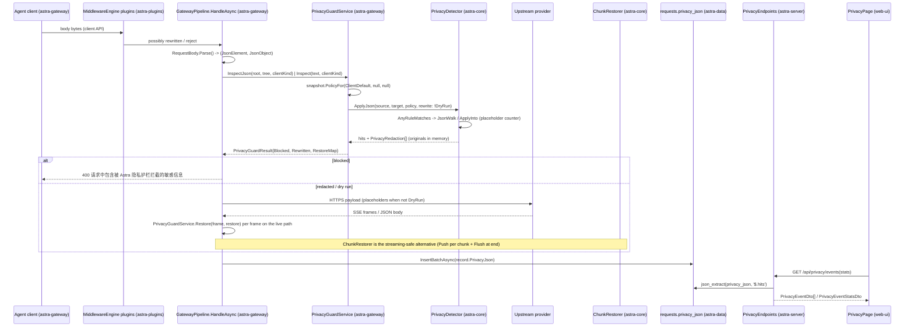

# Privacy redaction (guard scan → placeholder → restore → log)

**Trigger:** any client request that reaches the gateway (`GatewayPipeline.HandleAsync`) or the
`count_tokens` endpoint while the guard is enabled — or, deliberately, a *disabled* guard, which still
passes the body through the guard so the settings read is the only work done
(`src/Astra.Gateway/Pipeline/GatewayPipeline.cs:174`, `src/Astra.Gateway/Http/GatewayEndpoints.cs:150`).
**Outcome:** the upstream never sees the matched spans (they are `[REDACTED:<category>#<n>]` placeholders,
unique per request body, on the way out and the originals are put back on the way back); one row in
`requests` carries `privacy_json` with hits/actions/dry-run/redaction count (originals never persisted);
that row is what the console's interception log, stats, request detail and the provider probe show; and a
`block` action turned the request into a 400 before anything was sent.

## Steps
1. `src/Astra.Gateway/Pipeline/GatewayPipeline.cs:135` `RequestBody.ReadAsync` — the client body is read
   once into a pooled UTF-8 buffer (compression undone, ≤ 64 MiB, §6.5 captures a copy if enabled)
   (`astra-gateway`)
2. `src/Astra.Gateway/Pipeline/GatewayPipeline.cs:143` `middleware.BeginAsync` / `:150` `middlewareRun.Request`
   — magpie middleware plugins see the client's own API and body **first**, may rewrite or reject it;
   `MiddlewareResponseStream.Install` (`src/Astra.Gateway/Plugins/MiddlewareResponseStream.cs:44`) then wraps
   the response body (`astra-gateway`, `astra-plugins`)
3. `src/Astra.Gateway/Pipeline/GatewayPipeline.cs:166` `requestBody.Parse()` — one `JsonDocument` over those
   bytes; a JSON **object** takes the tree path, anything else (not JSON, not an object) the text path. The
   pipeline's later decode reads this same tree (`src/Astra.Gateway/Pipeline/RequestBody.cs:293`) (`astra-gateway`)
4. `src/Astra.Gateway/Pipeline/PrivacyGuardService.cs:162` `InspectJson(source, body, clientKind)` (or `:129`
   `Inspect(text, clientKind)`) — reads one `Snapshot` (a settings generation + a `ConcurrentDictionary`
   policy cache keyed by `PolicyKey(ClientDefault, EnabledOverride, DryRunOverride)`, `:50`/`:57`); disabled
   ⇒ `PassThrough` with the body untouched (`astra-gateway`)
5. `src/Astra.Core/Privacy/PrivacyTypes.cs:145` `EffectivePrivacyPolicy.Build` — materializes the rules:
   built-ins whose *effective* action is not `off`, then enabled custom rules; custom patterns go through
   `PrivacyDetector.Compile` (`PrivacyDetector.cs:135`). Effective action ladder
   (`PrivacyTypes.cs:139` `ActionFor`): `CategoryActions[ruleId]` → `CategoryActions[category]` →
   `ClientDefaults[clientKind]` → `DefaultAction` (`astra-core`; cached in `astra-gateway`)
6. `src/Astra.Core/Privacy/PrivacyDetector.cs:362` `ApplyJson(source, target, policy, rewrite)` → `:374`
   `Scan` → `JsonWalk` — walks the `JsonElement` without building `JsonNode`s: object properties are skipped
   by `IsOpaque` (`:600`), array items inherit the scope, strings are unescaped into a reused `ArrayPool<char>`
   buffer and first tested with the allocation-free `AnyRuleMatches` (`:220`) (`astra-core`)
7. `src/Astra.Core/Privacy/PrivacyDetector.cs:23` `BuiltInRules` — 22 ordered rules in 10 categories
   (`PrivacyTypes.cs:15`): 11 API-key shapes, AWS, PEM private key, JWT, email, phone, intranet host,
   credit card, CN ID / US SSN, connection string, credential assignment. Delimiter-driven ones (PEM, JWT,
   email candidate) use `Linear` = `RegexOptions.NonBacktracking` (`:84`); the rest are `[GeneratedRegex]`
   with a `BuiltinTimeoutMs = 5000` budget (`:80`), and each has a vectorized `SearchValues` "hint"
   (`RuleHint`, `:248`, e.g. `IntranetHints`, `CredentialKeywords`) or the digit-run fast path
   (`DigitRunMatches`, `:271`) so most text is rejected before a regex runs (`astra-core`).
   Commit `094860f` (0.7.0) is where this shape came from: every built-in was `Compile(pattern)`
   (a plain `Regex` with a 500 ms budget, `src/Astra.Core/Privacy/PrivacyDetector.cs` at `dbba043`) and
   redaction ran `rule.Regex.Replace(text, evaluator)` once per rule; it introduced `Linear`/`[GeneratedRegex]`,
   the custom `Matches` enumerator (email candidate, intranet hint), the single-string rewrites with a cursor
   and the per-rule `off` skip in `Scan`/`ApplyInto`
8. `src/Astra.Core/Privacy/PrivacyDetector.cs:174` `ApplyInto(text, policy, into)` — rules run **in order over
   the already-rewritten text**, so a later rule sees earlier placeholders; that is why the assignment rule
   carries `(?!\[REDACTED:)` (`:766`) and `builtin.credential-assignment` sits last: a later rule must not
   match a placeholder and redact the placeholder itself (`astra-core`)
9. `src/Astra.Core/Privacy/PrivacyDetector.cs:198` `PlaceholderFor(category, into.CounterFor(category))` — the
   counter lives on the single `PrivacyApplyResult` for the whole body (`:780`), so placeholders stay unique
   across the body's strings instead of restarting at `#1` per string; each replacement records
   `PrivacyRedaction { Placeholder, Original }` **in memory only** (`:200`). Masked samples (max 3/rule,
   `MaskSample`, `:690`) are attached to hits when `RecordSamples` (`astra-core`)
10. `src/Astra.Core/Privacy/PrivacyDetector.cs:600` `IsOpaque` — the protocol slots that are never scanned:
    base64 media under `source.data`/`inlineData.data`/`input_audio.data` + data-URL `image_url`/`file_data`
    (decided from ≤ 512 bytes: `IsBinaryDataUrl`, `:639`), Anthropic `thinking.signature`,
    `redacted_thinking.data`, `reasoning.encrypted_content`, and any `thoughtSignature`; arbitrary tool JSON
    keeps being scanned (`ChildScope`, `:582`) (`astra-core`)
11. `src/Astra.Gateway/Pipeline/PrivacyGuardService.cs:170` — dry run ⇒ original body kept; `applied.Blocked`
    ⇒ `Blocked = true`; otherwise `:174` builds `RestoreMap = placeholder → original` when
    `policy.Restore && settings.RestoreResponses`, and `Rewritten` says the tree was changed. Nothing
    matched ⇒ the original bytes go upstream untouched (`astra-gateway`)
12. `src/Astra.Gateway/Pipeline/GatewayPipeline.cs:185` `record.PrivacyJson = PrivacyGuardService.ReportJson(...)`
    (`PrivacyGuardService.cs:188` → snake_case `Json.Storage`); `:187` a block throws
    `GatewayException(400, "invalid_request_error", "请求中包含被 Astra 隐私护栏拦截的敏感信息…")` with
    `Status = Blocked`, rendered in the inbound protocol's error shape by the `catch (GatewayException)`
    (`:441`) (`astra-gateway`)
13. ⇢ crosses network boundary via HTTPS — `SendAsync` (`:388`, `:530`) sends the redacted payload (the client's
    own bytes when `!Rewritten`); policy, settings and the restore map were already read from one generation
    (`astra-gateway` → upstream provider). Policy reached the pipeline through DI only:
    `AstraApp.cs:92` `AddSingleton<PrivacyGuardService>` + `:253` `LoadAsync()` (loading `settings` key
    `"privacy"`, `PrivacySettings.StorageKey`) + `:281` `MapPrivacyEndpoints` (`astra-server`)
14. Response path (`restore = guard.RestoreMap`): `:432` `BufferAsync` → `:1080`/`:1113`
    `PrivacyGuardService.Restore(text, restore)` (an `Aggregate` of `string.Replace`) or
    `:1104` `WriteJsonAsync`, which writes straight to the pipe only when `restore.Count == 0 && capture is null`;
    `:430` `CollapseStreamAsync` → `:1176` `WriteJsonAsync`; `:427` `StreamAsync` → `:996` `WriteFrame` /
    `:968` `HandleNonSseBodyAsync` restore per SSE frame (`astra-gateway`, `astra-core`)
15. `src/Astra.Core/Privacy/ChunkRestorer.cs:8` `ChunkRestorer` — the streaming-safe restorer the gateway's own
    `Restore` calls are *not*: `_holdback = max(placeholder length) - 1` (`:18`), `Push` (`:31`) accumulates,
    replaces placeholders, and returns only `_pending[..^_holdback]`, holding the tail so a placeholder split
    across chunks can still complete; `""` means "nothing safe to write yet", **never** end-of-stream;
    `Flush` (`:46`) is the only thing that ends the stream. An empty map is a pass-through and `_holdback` is 0
    (`astra-core`)
16. `src/Astra.Gateway/Pipeline/GatewayPipeline.cs:509` `Finish` + `:510` `FinishTrace` →
    `:520` `usageWriter.EnqueueAsync(record)` → `UsageWriter` batch → `RequestRepository.InsertBatchAsync`
    (`src/Astra.Data/Repositories/RequestRepository.cs:297`, `privacy_json` at `:347`) (`astra-server`/`astra-data`)
17. ⇢ crosses process boundary via HTTP with cookies + `X-Astra-Admin: 1` (`web/src/api/client.ts`) —
    `web/src/api/hooks.ts:575` `usePrivacy`, `:578` `useUpdatePrivacy`, `:587` `usePrivacyDryRun`,
    `:607` `usePrivacyEvents`, `:615` `usePrivacyEventStats` (`web-ui` → `astra-server`)
18. `src/Astra.Server/Api/PrivacyEndpoints.cs:32` — `GET /api/privacy` (settings + built-in rule catalogue),
    `PUT /api/privacy` (`guard.UpdateAsync`, an invalid custom pattern ⇒ `ValidationProblem` on `customRules`),
    `POST /api/privacy/dry-run` (`:94`, forces `enabledOverride: true, dryRunOverride: false`), and the log:
    `GET /api/privacy/events` (`:55`) / `GET /api/privacy/events/stats` (`:77`) (`astra-server`)
19. `src/Astra.Data/Repositories/RequestRepository.cs:270` `PrivacyWhereSql` — the log is **not** a table: it is
    `requests` rows with `privacy_json IS NOT NULL`, filtered with `json_extract`/`json_each` over the report's
    `hits` (`:446` `QueryPrivacyEventsAsync`, `:473` `PrivacyEventStatsAsync`); columns from
    `src/Astra.Data/Migrations/0001_init.sql:180` (`privacy_json TEXT`, comment at `:140`), no privacy-specific
    migration (`astra-data`)
20. `web/src/pages/PrivacyPage.tsx:14` — `/privacy/:tab` tabs: `PrivacyOverview.tsx` (stats + category table +
    `PrivacyPolicyGroup` switches), `PrivacyEventLogs.tsx` (filters client/category/action/blocked, outcome
    badge, hit samples, `RequestDetailSheet`), `PrivacyRulesPanel` + `DryRunTester`
    (`web/src/components/PrivacyGuardSettings.tsx:69`, `:254`); labels via `PrivacyMeta.tsx`; routes
    `web/src/App.tsx:70` (`web-ui`)
21. Retention: `RetentionService` (`src/Astra.Gateway/Pipeline/UsageWriter.cs:117`) deletes request rows older
    than `AppSettings.RequestRetentionDays` (`DeleteOlderThanAsync`), so privacy events age out with the request
    log — there is no separate privacy retention (`astra-gateway`, `astra-core`)

## Sequence

## Errors and cancellation
- **Block is a normal 400, not an exception path**: `guard.Blocked` ⇒ `record.Status = RequestStatus.Blocked`
  then `throw new GatewayException(400, "invalid_request_error", …)` (`GatewayPipeline.cs:187`); the
  `catch (GatewayException)` keeps the `Blocked` status and encodes the message via
  `WriteErrorAsync` (`:1317`). The body is *not* redacted in that case and nothing goes upstream.
- **Dry run never changes the wire**: `Inspect` returns the original body and an empty restore map
  (`PrivacyGuardService.cs:143`); the report still records the hits with `DryRun = true`, and the console
  shows the "只检测" outcome instead of "脱敏" (`PrivacyEventLogs.tsx:195`).
- **Timeout / catastrophic patterns**: built-ins get 5 s (`BuiltinTimeoutMs`); custom patterns are compiled
  with 500 ms (`Compile`, `PrivacyDetector.cs:135`). `RegexMatchTimeoutException` is **not caught anywhere**
  in the repo (grep: no matches) — it propagates out of `InspectJson`/`Inspect`, i.e. a custom rule that
  blows up surfaces as the generic `catch (Exception)` → 500 "Astra 网关内部错误" and a `gateway_error`
  record, not as a privacy outcome.
- **An invalid custom pattern is rejected before publishing**: `UpdateAsync` compiles each enabled rule and
  throws `ArgumentException` with a Chinese message (`PrivacyGuardService.cs:107`), which
  `PUT /api/privacy` turns into `ValidationProblem` on `customRules` (`PrivacyEndpoints.cs:45`); the
  published snapshot and the stored settings both stay on the previous generation (test:
  `tests/Astra.Gateway.Tests/PrivacyGuardTests.cs:214`).
- Cancellation: the pipeline's `ct = ctx.RequestAborted`. A client that goes away mid-stream becomes
  `RequestStatus.ClientCancelled` (`GatewayPipeline.cs:459`, `:479`); the privacy work itself takes no token
  and is synchronous and bounded per body.
- Streaming: the hand-written `Push`/`Flush` pair on a `ChunkRestorer` must be used together — `Push`
  returning `""` is hold-back, not EOF. The current `StreamAsync` path instead calls
  `PrivacyGuardService.Restore` per frame/text (`GatewayPipeline.cs:968`, `:996`, `:999`), which cannot
  restore a placeholder split across two frames (the string is exact per frame by the time it is restored).

## Where to hook in
- **Add a built-in rule**: one entry in `PrivacyDetector.BuiltInRules` (`PrivacyDetector.cs:23`, order is
  evaluation order), preferably with a `SearchValues` hint in `AnyRuleMatches`/`HintFor` (`:220`, `:299`) and
  a `[GeneratedRegex(..., BuiltinTimeoutMs)]`-shaped pattern; the id/category it names is what
  `CategoryActions` (per-rule and per-category) and the console's category list key off, so a new *category*
  also needs a zh/en label (`web/src/components/PrivacyMeta.tsx:6`,
  `web/src/i18n/messages.ts` `settings.privacy.category.*`).
- **Add a detection category/action**: `PrivacyCategories.BuiltIn` (`PrivacyTypes.cs:29`) + `PrivacyActions.All`
  is the ladder the UI renders from `ACTION_KEY`/`activeOptions`; `action = off` drops the rule at policy
  build time, not at match time.
- **New settings field**: a property on `PrivacySettings` (`PrivacyTypes.cs:70`) plus web `PrivacySettingsDto`
  (`web/src/api/types.ts:530`) and both i18n catalogs — the blob is stored under `settings` key `"privacy"`,
  so no migration.
- **New event column/filter**: extend `PrivacyWhereSql` (`RequestRepository.cs:270`) and
  `PrivacyEventQuery`/`PrivacyEventDto` (`PrivacyEndpoints.cs:15`) together; the log is derived from
  `requests`, so a new field inside the report means changing `PrivacyReport` + `ReportJson` call sites.
- **New UI surface**: reuse `usePrivacy*` hooks (`web/src/api/hooks.ts:573`) and `PrivacyMeta` badges; the
  per-request view is `RequestDetailSheet` (`web/src/pages/RequestsPage.tsx`, mounted from
  `PrivacyEventLogs.tsx:190`).
- **Do not** route a *new* response path around the restore map: `WriteJsonAsync`/`BufferAsync` check
  `restore.Count == 0` to skip materializing text, and the fast pass-through flags in `StreamAsync`
  (`forwardBytes`, `:854`) are computed from `restore.Count` — a new writer that ignores `restore` leaks
  placeholders to the client while the log still says "redacted".
- **Do not** reuse one `PrivacyApplyResult`'s counters across requests, and do not move the placeholder
  counter into the detector instance: uniqueness is per body (`ApplyInto` comment, `PrivacyDetector.cs:170`).
- **Do not** add chart/event types to the `PolicyState` clean cache (`:404`) beyond digests of *clean* strings —
  it is keyed by SHA-256 of the raw UTF-8 and cleared at 16 384 entries, and remembering matches would turn it
  into a secrets store.
- **Do not** try to restore inside a middleware plugin's `onEvent` as a substitute for the restorer: middleware
  runs *before* the guard on the request and wraps the response body
  (`MiddlewareResponseStream.Install`, `:44`), so it sees placeholders, not originals.

## Related
- Modules: [astra-gateway](../modules/astra-gateway.md), [astra-core](../modules/astra-core.md),
  [astra-server](../modules/astra-server.md), [astra-data](../modules/astra-data.md),
  [web-ui](../modules/web-ui.md), [astra-plugins](../modules/astra-plugins.md)
