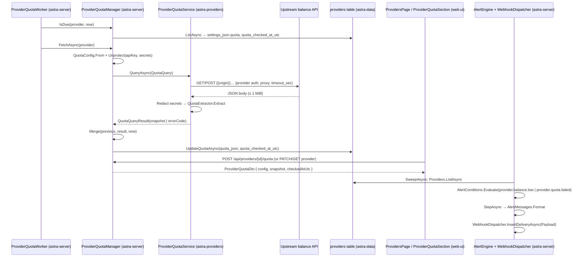

# Provider quota refresh (API-key providers' balance / usage query)

**Trigger:** three ways in — (a) the background `ProviderQuotaWorker` tick finds a provider due;
(b) the user clicks *Query now* / the refresh button in the console (`POST /api/providers/{id}/quota`);
(c) the user saves the query switched on, which immediately fires the same POST.
**Outcome:** `providers.quota_json` holds the last good snapshot (`{fetchedAtUtc, template, kind, isValid,
planLabel?, plans:[…]}`, or the previous snapshot plus `error`/`errorCode`/`errorAtUtc`/`failures` after a
failure) and `providers.quota_checked_at_utc` holds the time of the last attempt; the console renders it on
the provider card, the detail page and the tray; the next alert sweep turns a low `remaining` / high
`usedPercent` / repeated `failures` into a notification + webhook delivery. Nothing else about the provider
changes — a refused balance endpoint never disables a key that can still call models.

## Steps
1. `src/Astra.Server/Hosting/ProviderQuotaWorker.cs:27` — `ExecuteAsync` waits `InitialDelay` = 30 s once, then loops:
   `RefreshDueAsync` (provider queries) + `SubscriptionQuotaSync.RefreshDueAsync(MaxPerRound - queried)` (subscription
   accounts get the round's remaining slots), then `Tick` = 1 min (`astra-server`)
2. `src/Astra.Server/Hosting/ProviderQuotaWorker.cs:66` — `RefreshDueAsync` lists all providers, keeps
   `quota.IsDue(p, now)`, orders by `QuotaCheckedAtUtc` oldest-first, `.Take(MaxPerRound)` = 10, and awaits each in
   turn (serial, no parallelism) (`astra-server`)
3. `src/Astra.Server/Api/ProviderQuotaManager.cs:118` — `IsDue`: skip `!Enabled`, skip `AuthSchemes.OAuthSubscription`,
   skip `settings.quota.enabled == false`; interval = `config.IntervalMinutes` ?? global `AppSettings.QuotaAutoIntervalMinutes`
   (default 30, `src/Astra.Core/AppSettings.cs:47`, clamped 0–1440); `0` = never; after `Failures(quota) >= 3` (i.e. the
   recorded failure count, not a separate counter) the interval is ×`BackoffFactor` = 4; due when
   `QuotaCheckedAtUtc` is null or `now - last >= interval`. Note the backoff uses the failure count *including* the
   failure that just happened, and the count only rises on failed attempts (`astra-server`, `astra-core`)
4. `src/Astra.Server/Api/ProviderQuotaManager.cs:50` — `FetchAsync`: `QuotaConfig.From(provider.Settings)` (the stored
   snake_case node), `ApiKey(provider)` (`ISecretProtector.Unprotect`, `CryptographicException` → null),
   `Decrypt(config.Secrets)` (an unreadable secret is treated as not set) → `ProviderQuotaService.QueryAsync`
   (`astra-server`, `astra-core`)
5. `src/Astra.Providers/Quota/ProviderQuotaService.cs:68` — `QueryAsync`. Rejects account-based schemes
   (`AuthSchemes.UsesAccounts` → `config`), resolves the template via `Effective` (`:57`: custom config becomes an ad-hoc
   template; `null` → `QuotaTemplateCatalog.Suggest`; otherwise `catalog.Get(id)`), then builds the variable map
   (`params` + decrypted secrets, plus computed `baseUrl` / `origin` / `host` / `apiKey`) and requires every
   `template.Params` entry with `Required = true` (`astra-providers`)
6. `src/Astra.Providers/Quota/ProviderQuotaService.cs:96` — `QuotaConfig.Fill` substitutes `{{name}}` in the URL (escaping
   everything except `origin`/`baseUrl`) and in each header; missing names are collected, `apiKey` missing → `no_key`,
   any other missing name → `config` (`astra-providers`)
7. `src/Astra.Providers/Quota/ProviderQuotaService.cs:101` — auth follows the provider's own scheme, exactly like the
   gateway: `XApiKey` → `x-api-key`, `XGoogApiKey` → `x-goog-api-key`, `QueryKey` → `?key=…`, `AuthSchemes.None` → nothing,
   default → `Authorization: Bearer …`; `auth: "none"` in a request spec skips all of this (`astra-providers`)
8. ⇢ crosses network boundary via HTTPS to the provider's base URL (or `config.BaseUrl`): `HttpClient` named
   `astra-provider-quota` (90 s outer bound, `src/Astra.Server/Hosting/AstraApp.cs:214`), or a **per-query throwaway
   client** with the provider's `HttpProxy` (`ProviderQuotaService.cs:203`, `AllowAutoRedirect = false`); the per-query
   deadline is `settings.quota.timeout_sec` via a linked `CancellationTokenSource` (`:134`) (`astra-providers` → upstream)
9. `src/Astra.Providers/Quota/ProviderQuotaService.cs:209` — body read is capped at `MaxResponseBytes` = 1 MiB
   (`too_large`), parsed leniently (`TryParse` → `not_json`), then **redacted**: `Redact` (`:249`) replaces every secret of
   ≥ 4 characters (and its percent-encoded form) with `••••` in the shown URL, the raw JSON and error messages
   (`astra-providers`)
10. `src/Astra.Providers/Quota/ProviderQuotaService.cs:160` — non-2xx mapped to `unauthorized` (401/403), `no_endpoint`
    (404/405/501), `rate_limited` (429), `upstream` (rest), each appending a lenient upstream message found by
    `UpstreamMessage` (`:239`, tries `error.message`, `error`, `message`, `msg`, `base_resp.status_msg`); success runs
    `QuotaExtractor.Extract` and, when no plan and `isValid != false`, returns `empty`; otherwise builds the snapshot
    `{fetchedAtUtc, template, kind, isValid, invalidMessage?, planLabel?, plans:[…]}` (`:181`) (`astra-providers`)
11. `src/Astra.Server/Api/ProviderQuotaManager.cs:159` — `Merge`: on success the fresh snapshot replaces the old one; on
    failure the previous snapshot is kept and `error`, `errorCode`, `errorAtUtc`, `failures` (previous + 1) are written on
    top of it, so the console can show the last good figures next to a newer failure. `UpdateQuotaAsync` writes both
    columns only (`src/Astra.Data/Repositories/ProviderRepository.cs:193`, `UPDATE providers SET quota_json, quota_checked_at_utc`),
    deliberately **not** `updated_at` (`astra-data`)
12. `src/Astra.Server/Alerts/AlertEngine.cs:114` — `SweepAsync` (own service, `InitialDelay` 20 s then every
    `SweepInterval` 1 min, `:36`–`:37`) reads stored data only: for every provider
    `!AuthSchemes.UsesAccounts(p.AuthScheme) && p.Quota is not null` it emits
    `AlertSignal("provider", id, name, { quota = p.Quota })` (`:124`) (`astra-server` → `astra-core`)
13. `src/Astra.Core/Alerts/AlertContracts.cs:132` — `AlertConditions.Evaluate` per rule: `provider.balance.low` →
    `Balance` (`:146`, needs `quota.plans`, returns null when `isValid == false`; picks the first plan matching the
    optional `plan` name; `metric = "remaining"` fires when `figure < value`, `metric = "usedPercent"` fires when
    `figure >= value`), `provider.quota.failed` → `Failures` (`:176`, fires when `quota.failures >= value`; it reports
    `{failures, error}`) (`astra-core`)
14. `src/Astra.Server/Alerts/AlertEngine.cs:180` — `StepAsync` runs the ok↔firing state machine per (rule, subject),
    within `cooldown_minutes` suppression and `repeat_minutes` re-notify, formats the message via
    `AlertMessages.Format` (`src/Astra.Server/Alerts/AlertMessages.cs:20`) and inserts one pending delivery per target
    webhook; `WebhookDispatcher.Payload` (`src/Astra.Server/Alerts/WebhookDispatcher.cs:255`) sends
    `{id, event, status: firing|resolved, repeat, occurredAt, rule, subject{type,id,name}, condition, observed, message,
    astra{version,url}}` — `observed` for balance-low is `{plan, unit, remaining, total, usedPercent}` (`astra-server`)

### On-demand path (the same service, driven by the UI)
15. `web/src/pages/ProvidersPage.tsx:294` / `web/src/pages/ProviderDetailPage.tsx:699` — `ProviderQuotaLine` on the card and
    `ProviderQuotaSection` on the detail page render the snapshot; *Query now* / the refresh button and the save flow call
    `useFetchProviderQuota` / `useSaveProviderQuotaConfig` / `useTestProviderQuota` (`web/src/api/hooks.ts:452`, `:462`,
    `:471`); enabling a previously-off query immediately POSTs once (`ProviderQuotaSection.tsx:144`–`:156`) (`web-ui`)
16. ⇢ crosses process boundary via HTTP with cookies + `X-Astra-Admin: 1` (`web/src/api/client.ts`):
    `GET /api/providers/{id}/quota`, `POST /api/providers/{id}/quota`, `POST /api/providers/{id}/quota/test`,
    `PUT /api/providers/{id}/quota/config`, `GET /api/provider-quota/templates` (`web-ui` → `astra-server`)
17. `src/Astra.Server/Api/ProviderEndpoints.cs:381`–`:408` — the routes. POST `/quota` requires an API-key provider
    (`RequireApiKeyProvider`, `:411`), runs `FetchAsync` (which **persists**) and answers 400
    `{error, details:{errorCode}}` only when `QuotaErrors.IsConfiguration` (i.e. `config` / `no_key`); a network or
    upstream failure still returns 200 with the merged snapshot holding the error. `POST /quota/test` runs an unsaved config
    and persists nothing. `PUT /quota/config` goes through `ProviderQuotaManager.FromInput` then writes
    `p.Settings[QuotaConfig.SettingsKey] = config.ToNode()` with a full `UpdateAsync` (`astra-server`)
18. `src/Astra.Server/Api/ProviderEndpoints.cs:553` — `ProviderWriteFilter` deliberately **skips** the provider
    read-modify-write semaphore for GETs, `*/test` and `POST */quota`, because a quota query writes only the two quota
    columns; it still guards `PUT /quota/config` (`astra-server`)

## Sequence

## Errors and cancellation
- `ProviderQuotaService.QueryAsync` **returns** failures, never throws: `config`, `no_key`, `unauthorized`, `no_endpoint`,
  `rate_limited`, `upstream`, `timeout`, `network`, `not_json`, `too_large`, `empty` (`ProviderQuotaService.cs:12`–`:24`).
  Only `config` / `no_key` are "configuration" errors, and that flag is what the HTTP layer turns into a 400/502-style
  rejection (`QuotaErrors.IsConfiguration`, `ProviderEndpoints.cs:388`).
- Cancellation: the per-query deadline is a linked CTS (`ProviderQuotaService.cs:134`); an `OperationCanceledException`
  whose outer token is *not* cancelled becomes `timeout` (`:147`), a cancelled outer token propagates. The worker catches
  `OperationCanceledException` when the host token is cancelled and returns; any other exception per provider is logged
  and retried next round (`ProviderQuotaWorker.cs:45`–`:51`, `:81`).
- The worker can never corrupt a provider: it only calls `UpdateQuotaAsync`, which touches `quota_json` /
  `quota_checked_at_utc` and not `updated_at` (`ProviderRepository.cs:190`), so it cannot race a settings edit.
- A failed query is never lost: `Merge` keeps the last good snapshot and stacks `error`/`errorCode`/`errorAtUtc`/`failures`
  on it, and `failures` is what drives the ×4 backoff (`ProviderQuotaManager.cs:44`, `:170`).
- Alert evaluation is deliberately indecisive where it must be: `Balance` returns `null` (state kept, no notification) when
  there are no `plans` or `isValid == false`, and a plan without the requested figure is skipped — so a broken or
  unauthorized balance query does not fire "balance low" (`AlertContracts.cs:146`–`:169`).
- Webhook delivery is decoupled from the fetch: `StepAsync` only inserts pending deliveries and calls `dispatcher.Wake()`;
  formatting failures are the dispatcher's problem, not the worker's.

## Where to hook in
- **Add a built-in query**: one entry in `src/Astra.Providers/Quota/quota-templates.json` (embedded via
  `src/Astra.Providers/Astra.Providers.csproj:11`, `<EmbeddedResource Include="Quota\*.json" />`). It is validated at load:
  `QuotaTemplateCatalog.Load` (`QuotaTemplate.cs:91`) runs `QuotaConfig.ValidateRequest` + `QuotaExtractor.Validate` over
  every template and **throws** on a bad or duplicate id, unknown operator, unsupported field or bad URL, so a typo is a
  startup/first-use failure, not a silent no-op. `Suggest` (`:70`) picks by `appliesTo` (provider template id) first, then
  by exact `hosts` match on an endpoint's host; `custom-*` template ids only fall back to a host match. A template with
  `kind: "plan"` is for usage windows, `"balance"` for money left.
- **New operator / extractor field**: add it in `QuotaExpression.Operate`/`ValidateOperator` (`QuotaExpression.cs:140`,
  `:243`) or `QuotaExtractor` (`PlanValueKeys`/`PlanKeys`/`TopKeys`, `:22`–`:27`) **and** in the UI hint text, because the
  custom-quote textarea is free JSON and the server is the only validator.
- **New global knob**: `AppSettings.QuotaAutoIntervalMinutes` (`AppSettings.cs:47`) is already read through
  `EffectiveIntervalMinutes`; adding a setting means a property + `RequestEndpoints.cs:303` wiring + web i18n.
- **New UI surface**: reuse `lib/quota.ts` (`quotaEnabled`, `quotaSummary`, `quotaFailure`, `planPhrase`) and
  `ProviderQuotaSection.tsx:298` `QuotaSnapshotView` — the tray uses the same snapshots through `providerQuotaPlans`
  (`web/src/lib/tray.ts:118`).
- **Do not** try to add a `quota` field to a provider settings write: `PATCH /api/providers/{id}` strips
  `settings.quota` and re-injects the stored node (`ProviderEndpoints.cs:128`–`:132`), and `PublicSettings`
  (`ProviderQuotaManager.cs:151`) removes it from every DTO so encrypted secrets never leave through the provider endpoint.
- **Do not** widen the fetch to account-based schemes: `AuthSchemes.UsesAccounts` short-circuits with `config`, and
  `RequireApiKeyProvider` rejects the routes; subscription accounts have their own service
  (`SubscriptionQuotaService` / `SubscriptionQuotaSync`) and their own snapshot inside
  `provider_accounts.extra_json.quota`.

## Related
- Modules: [astra-server](../modules/astra-server.md), [astra-providers](../modules/astra-providers.md),
  [astra-data](../modules/astra-data.md), [astra-core](../modules/astra-core.md), [web-ui](../modules/web-ui.md)
