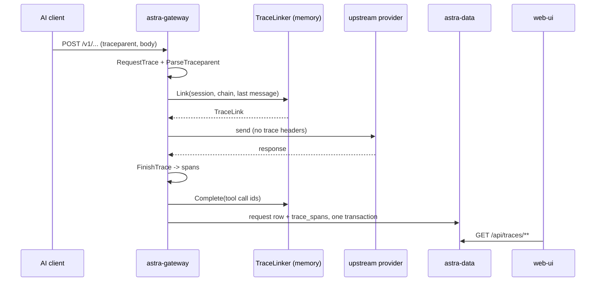

# Request tracing (agent → Astra → provider)

**Trigger:** the same one as [gateway-request](gateway-request.md) — an AI client posts a generation request. Nothing
is configured on the agent side; Astra infers the conversation from the traffic itself (`.plan/observability.md`).
**Outcome:** the request row carries where the call sits in its agent's loop, and `trace_spans` holds one span per
stage of that call. The console's 链路追踪 views and `GET /api/traces/**` read both back.

## Steps

1. `src/Astra.Gateway/Pipeline/GatewayPipeline.cs:GatewayPipeline.HandleAsync` — opens a `RequestTrace` with the
   request and reads the inbound `traceparent` through `Tracing/TraceKeys.cs:TraceKeys.ParseTraceparent`. Its trace id
   names a turn the request opens; its span id becomes `RequestRecord.ParentSpanId`. Nothing of it is forwarded.
2. `src/Astra.Gateway/Pipeline/Upstream.cs:GatewayHttpClients` — the upstream `HttpClient` sets
   `ActivityHeadersPropagator = DistributedContextPropagator.CreateNoOutputPropagator()`, so the agent's
   `traceparent`, `tracestate`, `baggage` and `Request-Id` never reach the provider. `UpstreamTraceHeadersTests`
   asserts that against the real handler; the integration fixture swaps the handler out, so it cannot.
3. Each stage of `HandleAsync` opens and closes a span on that trace: `gateway.route` (auth, routing, the token-limit
   check), `gateway.body`, `gateway.middleware` (only when a plugin ran), `gateway.privacy`, `gateway.resolve`
   (provider, model, capability discovery — timed on its own), `gateway.encode`, one `upstream.attempt` per send
   (`TraceSpanKinds.Client`, carrying `astra.provider.id` / `astra.provider.name`), and `gateway.response`. A provider-pool
   failover repeats `gateway.resolve` / `gateway.encode` for the next member and marks the failed attempt
   `astra.attempt.retry = provider_failover`; `TraceRepository.TopologyAsync` and `ProviderStatsAsync` credit each attempt
   to its own provider, and the web request view takes the last resolve / encode span. The names are `TraceSpanNames`
   (`src/Astra.Core/Requests/TraceSpan.cs:TraceSpanNames`).
4. `Tracing/TraceKeys.cs:TraceKeys` — `ChainOf`, `SessionOf` and `LastMessageOf` read the client's own body and
   headers **before** the privacy guard rewrites the tree and before any codec translates it, so the pass-through and
   conversion paths agree. A session id that looks like one is kept verbatim (`cc:` / `codex:`); everything else is
   hashed. Unknown shapes give nothing — the helpers never throw.
5. `Tracing/TraceKeys.Cause.cs:TraceKeys.CauseOf` — after the privacy guard, from the **guarded** tree: whether the call
   carries the user's input or tool results (each named after the call it answers, found in the history the request
   re-sends, with its error mark and size). Root span `astra.request.cause` (+ `astra.request.prompt`, the first 300
   characters, only while `AppSettings.TraceContent` is on) and one `tool_result` event per result; also
   `RequestRecord.LiveCause` for the live feed.
6. `Tracing/TraceLinker.cs:TraceLinker.Link` — places the call. A tool result whose id was seen continues that call
   (`link_source = tool_call`, `step + 1`); one that was not falls back to the chain's latest call (`session`). A user
   message opens a turn on the main chain (`new_turn`), or — on another chain of the same session — a sub-agent while
   the main chain still waits on tool calls (`sidechain`) or a side call (`aux`), both `inferred`.
7. Every attempt that gets its account and every attempt that ends calls `AttemptTrace.Changed`, which puts
   `RequestTrace.Attempts()` (a snapshot of the `upstream.attempt` spans so far) on `RequestRecord.LiveAttempts` and
   updates the live feed — the topology draws the account a call is on and a retry as it happens.
8. `GatewayPipeline.FinishTrace` — writes `FinishReason` and `ToolCalls` onto the record, closes the response span
   (events `first_token`, `reasoning_start`/`reasoning_end`, `text_start`/`text_end`, `tool_call` with `name` / `id` and,
   while `TraceContent` is on, `arguments` cut at 4 KB; `astra.response.text` = the reply's first 300 characters under the
   same switch), ends the root span, and calls `RequestTrace.Build`. Spans still open end with the root and are marked
   `error`/`incomplete`. `TraceLinker.Complete` remembers the tool-call ids the response asked for. `LivePhases` stays
   on the record (never stored) so the live feed's last event keeps it until the row is written.
9. `src/Astra.Data/Repositories/RequestRepository.cs:RequestRepository.InsertBatchAsync` — the span rows go into
   `trace_spans` in the same transaction as the request row (`ON DELETE CASCADE`, so request-log retention removes
   both). Rows logged before migration `0017_tracing.sql` simply have no trace; nothing is back-filled.
10. ⇢ HTTP: `src/Astra.Server/Api/TraceEndpoints.cs:TraceEndpoints.MapTraceEndpoints` (registered in
   `AstraApp.Create`) serves `GET /api/traces/requests/{id}`, `/sessions`, `/sessions/{key}`, `/topology` (each
   account's attempts / errors in the window) and `/activity` (the latest requests as `TraceActivityDto`: cause, attempts,
   thinking, reply, tool calls — built from the root / attempt / response spans by `ToActivity`). The live feed
   (`/api/requests/live`) carries `attempts`, `cause` and `phases` on every event of a request. A call
   still in flight is answered from `LiveRequestFeed` with an empty span list — spans are written once, with the row.
   `TraceRepository` (`src/Astra.Data/Repositories/TraceRepository.cs:TraceRepository`) is the read side;
   `TraceStats.Percentile` (`src/Astra.Core/Requests/TraceStats.cs:TraceStats`) computes the P50/P95.
11. ⇢ HTTP: `web/src/pages/TracesPage.tsx:TracesPage` renders the three views through
   `web/src/components/traces/` (`canvas.tsx`, `topology.tsx` + `activity.tsx` — the activity rail, `session.tsx`,
   `request.tsx`, `inspector.tsx`), laid out by the pure builders in `model.ts` (the topology's provider nodes have one
   row and one edge per account, `accountRowId`; `activityItems` merges the live feed into the stored activity). `SPAN` there repeats `TraceSpanNames`, and the hooks are
   `useTraceTopology` / `useTraceSessions` / `useTraceSession` / `useTraceRequest` (`web/src/api/hooks.ts`). The live
   particles reuse the existing `/api/requests/live` stream.

## Sequence

## Errors and cancellation

- A request refused before its body was read still gets a trace: the agent's trace id when it sent one, otherwise one
  of Astra's own (`FinishTrace`). A request that dies mid-flight has its open spans closed at the root's end and
  marked `error`/`incomplete` (`RequestTrace.Build`).
- `TraceKeys` swallows a malformed body and returns nothing, so a trace is never why a request fails.
- Topology percentiles sample the most recent `TraceRepository.SampleLimit` (5000) requests of the window, so a busy
  day stays cheap and the number is an approximation, not an exact aggregate.
- `link_source` says how sure the link is. `tool_call` is exact; `session` means the tool call was not in memory
  (a restart, or an id evicted past `TraceLinker.MaxToolCalls`); `inferred` is a guess. The views must not present
  every parent as a fact.

## Where to hook in

- **A new stage that should be visible:** open a span with `RequestTrace.Start` inside `HandleAsync`, add its name to
  `TraceSpanNames`, and then to `web/src/components/traces/model.ts` `SPAN` plus the topology stage order in
  `TraceEndpoints.TopologyAsync` and the attribute keys `TraceRepository` groups by. Renaming one without the others
  makes the stage vanish from the canvas while the row is still written. `docs/content/docs/console/traces.mdx` lists
  what is recorded.
- **Content in the trace** (anything copied from the conversation — arguments, prompt, reply) stays behind
  `AppSettings.TraceContent` (off by default; `.agents/memory/trace-routing-visualization.md`). Names, counts, timings
  and attempts are recorded either way.
- **A new agent identity:** extend `TraceKeys`, not the pipeline. It has to be readable from the client's own body,
  because the pass-through path never builds an IR.
- **Looks tempting but breaks:** forwarding the inbound `traceparent` upstream (the propagator is disabled on
  purpose), treating `TraceLinker`'s in-memory maps as durable, and editing migration `0017` instead of adding a new
  one.

## Related

- Modules: [astra-gateway](../modules/astra-gateway.md), [astra-core](../modules/astra-core.md),
  [astra-data](../modules/astra-data.md), [astra-server](../modules/astra-server.md),
  [web-ui](../modules/web-ui.md), [docs-site](../modules/docs-site.md)
- [gateway-request](gateway-request.md) — the flow this records.
