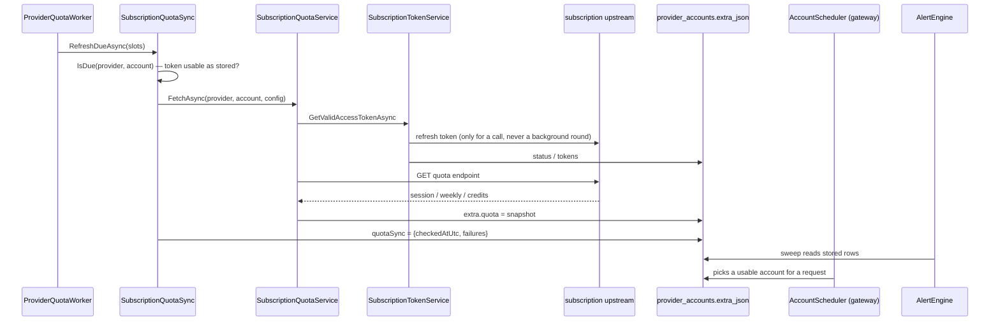

# Subscription account refresh

**Trigger:** a request (or a quota query the user asks for) needs an account's token, `ProviderQuotaWorker`'s tick finds
a subscription account's quota due, a manual refresh in the console, an import of a new sign-in, or an upstream 401/403
during a request. Nothing renews tokens on a timer: an idle account's access token simply lapses until its next use
(the `SubscriptionRefreshWorker` that did so every 5 min was removed on 2026-10-30, at the user's request).
**Outcome:** the account's OAuth token is refreshed if needed, its 5-hour/weekly/credit quota is re-fetched and stored
as a snapshot, its status (`active` / `expired` / `revoked`) reflects reality, the gateway's account scheduler can use
it, and the console plus the alert engine see the new state.

## Steps

1. `src/Astra.Server/Hosting/ProviderQuotaWorker.cs:ProviderQuotaWorker.ExecuteAsync` — waits `InitialDelay` (30 s)
   then ticks every minute; each round gives the provider-quota slots it did not use to subscription accounts (at most
   `MaxPerRound` = 10 queries in total).
2. `src/Astra.Server/Api/SubscriptionQuotaSync.cs:SubscriptionQuotaSync.IsDue` — an account is due when its provider is
   an enabled OAuth subscription, the account is enabled and `Active`, `SubscriptionQuotaService.CanProbe` says the
   family has a probe, and its access token is usable as stored (`SubscriptionTokenService.IsFresh(account, now)`): a
   background round never renews a token, so an account whose token lapsed waits — counting no failure — until a
   request renews it; the interval is multiplied by the failure backoff (`BackoffFactor` after
   `ProviderQuotaManager.BackoffAfterFailures`, ×4). `RefreshDueAsync` takes the least recently checked first.
2b. `SubscriptionQuotaSync.RecheckCooledAsync` (called by `ProviderQuotaWorker` before `RefreshDueAsync`, same 1-min tick
   and round budget) re-queries accounts that are cooling down after a 429 every `CooledRecheck` (5 min, ×4 after
   repeated failures; off with the background refresh; skipped like `IsDue` while the token needs renewing), and `ReleaseIfRecoveredAsync` clears `cooldown_until_utc` when
   the stored snapshot has room (`HasHeadroom`: at least one of session/weekly/credits `usedPercent`, none >= 100).
   The reset-credit consume and manual quota endpoints call `ReleaseIfRecoveredAsync` right after their fetch.
   Auth-rejection cooldowns are excluded from quota recovery (`LastError` starts with `401 ` / `403 `); headroom on a
   usage endpoint does not prove that the inference model/channel accepts the account.
3. `src/Astra.Providers/Subscription/SubscriptionQuotaService.cs:SubscriptionQuotaService.FetchAsync` — the family key
   is the provider *template id* (`TemplateId ?? PriceKey ?? Id`, deliberately mirroring the gateway's
   `SubscriptionSupport.ProviderKeyOf`); a Claude `setup-token` account returns no quota on purpose. The switch maps
   `claude-subscription`, `openai-subscription`, `grok-subscription`, `zcode-subscription`/`bigmodel-subscription`,
   `github-copilot-subscription`, `kimi-subscription`; anything else returns null so the UI can say "not supported"
   rather than guess a field name. **A new probe must be added to `ProbedFamilies` too**, or the family is never
   background-refreshed and never alert-visible.
4. The outbound proxy for this call is an `AsyncLocal` set from the account (`ProxiedHttpClients.ProxyOf`, account
   proxy > provider proxy > system proxy), so concurrent queries of different accounts cannot borrow each other's.
5. Token: `src/Astra.Providers/Subscription/SubscriptionTokenService.cs:SubscriptionTokenService.GetValidAccessTokenAsync`
   returns a usable access token, calling `RefreshAsync(force: false)` when the stored one is not fresh
   (`IsFresh`: `Active` + a token + more than `RefreshLead` left for a renewal grant; a direct token stays valid until
   its actual expiry, and an API-key account never expires). `CanRefresh` requires an OAuth account with a renewal grant.
6. `SubscriptionTokenService.RefreshAsync` — serialized per account by a semaphore, re-reads the row before acting, and
   decides status: an OAuth `invalid_grant` → `Revoked`; any other OAuth error → `Expired`; a missing or undecryptable
   refresh token → `Expired`; an API-key account told to force-refresh → `Revoked` (the key itself was rejected). A
   transport failure changes nothing. `RefreshAfterUnauthorizedAsync` is the forced variant used after a 401.
7. ⇢ network: the probe queries the family's own quota endpoint through `SubscriptionQuotaService.SendAsync`. The
   snapshot is `{fetchedAtUtc, session, weekly, credits, planLabel}` (`IsFresh` reads `quota.fetchedAtUtc` using
   `TimeProvider.System`, not the injected clock). `IsAuthRejection` treats 401/403 as a dead grant **only with a JSON
   body** — a Cloudflare HTML 403 is tolerated, because otherwise a refresh cycle would revoke healthy accounts.
8. ⇢ database: `SubscriptionQuotaService.FetchAsync` re-reads the account (`accounts.GetAsync`) before writing, then
   stores the snapshot in `provider_accounts.extra_json.quota` via `IProviderAccountStore.UpdateAsync`.
   `SubscriptionQuotaSync.RefreshAsync` re-reads again after the fetch (a token refresh may have written meanwhile),
   and keeps the sync bookkeeping under `extra.quotaSync` = `{checkedAtUtc, failures, error}` next to the last good
   snapshot; a success removes it.
9. ⇢ in-process: requests pick an account through `src/Astra.Gateway/Pipeline/AccountScheduler.cs` (switch mode
   `manual` / `failover` / `balanced`; `StickyKeys` keeps one conversation on one account — in-memory bindings with a
   1 h idle TTL), and `UpstreamAuthResolver` supplies credentials with `UpstreamAuth.CanRefresh`. A 401/403 forces one
   renewal/reload only when supported; direct tokens and API keys skip renewal. Failover/balanced modes cool a still
   rejected account for 10 min and hand over (`auth_failover`), including when renewal succeeded but inference still
   refuses it. Resolution failures (e.g. a direct token that already expired) also hand over. Manual mode preserves
   the upstream rejection. Attempts exclude accounts already tried; a channel rejection alone does not revoke a grant.
10. ⇢ HTTP: `src/Astra.Server/Api/SubscriptionEndpoints.cs` (and `SubscriptionEndpoints.Import.cs`) serve accounts,
    import and manual refresh; the console renders them from `web/src/components/Subscription*.tsx`.
11. ⇢ in-process: `src/Astra.Server/Alerts/AlertEngine.cs:AlertEngine.SweepAsync` derives account observations from
    the **stored rows** every minute instead of this module reporting signals — `SubscriptionQuotaService` has no
    `IAlertSignals` dependency. Events: `account.quota.high`, `account.auth.invalid`, `account.quota.failed`
    (`src/Astra.Core/Alerts/AlertContracts.cs:AlertEvents.All`), delivered by `Alerts/WebhookDispatcher.cs`.

## Sequence

## Errors and cancellation

- A probe failure never throws out of the worker: `SubscriptionQuotaSync.RefreshAsync` catches it, logs, and records
  `extra.quotaSync.error` / `failures`; the last good snapshot stays visible and the backoff grows.
- `SubscriptionAuthException` from the token service is the "needs re-login" signal and reaches the caller as an
  admin API error or a gateway error depending on who asked; the account status was already written.
- `OAuthProtocolException` carries `IsInvalidGrant`, which is what separates `Revoked` from `Expired`.
- Cancellation: the worker passes `stoppingToken` into the probe; the post-fetch bookkeeping writes use
  `CancellationToken.None` so a shutdown mid-round still records what happened.
- A Copilot account imported as a bare token (no refresh token) returns null from `ProbeCopilotAsync` instead of
  being marked revoked.

## Where to hook in

- **Supported:** a new subscription family is a `SubscriptionOAuthConfig` keyed by the template id plus a
  `*-subscription` provider template, then a `case` in `FetchAsync` **and** an entry in `ProbedFamilies`, a
  `SubscriptionQuotaService` probe method, the account-status handling in `SubscriptionTokenService.RefreshAsync`, and
  the console's account card.
- **Supported:** the on-demand path is the same `FetchAsync` through `SubscriptionEndpoints.cs`; there is no separate
  implementation to keep in step.
- **Looks tempting but breaks:** omitting the `ProbedFamilies` entry (the family silently never refreshes and never
  alerts); treating a 403 without checking the body (a Cloudflare HTML block revokes a healthy account); reading the
  account once around the fetch instead of re-reading (a token refresh during the fetch is lost); relying on
  `AccountScheduler`'s in-memory bindings across a restart (they are gone — the conversation simply re-picks).

## Related
- Modules: [astra-providers](../modules/astra-providers.md), [astra-server](../modules/astra-server.md),
  [astra-data](../modules/astra-data.md), [astra-core](../modules/astra-core.md),
  [astra-gateway](../modules/astra-gateway.md), [web-ui](../modules/web-ui.md)
- [provider-quota-refresh](provider-quota-refresh.md), [gateway-request](gateway-request.md),
  [admin-api-request](admin-api-request.md)
