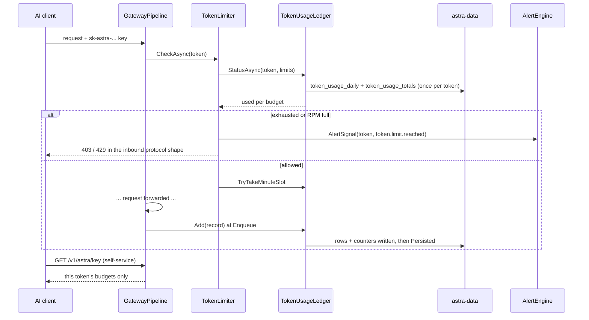

# Token limits enforcement

**Trigger:** someone posted a request with a gateway token (`sk-astra-…`), or the token's holder opened the
self-service balance view.
**Outcome:** a request that would exceed a budget or the RPM window is refused with a protocol-shaped error and *not*
counted against the budget again; a request let through is counted in the in-memory ledger immediately and in
`token_usage_totals` / `token_usage_daily` when its row is written; the holder can read their own remaining allowance
without ever seeing upstream providers or accounts.

## Steps

1. `src/Astra.Core/Tokens/TokenLimits.cs:TokenLimits` — the budget model: a list of `TokenBudget` (`metric:period`
   key, metric ∈ `cost` / `requests` / `tokens`, period ∈ `day` / `week` / `month` / `total`) plus an optional `Rpm`.
   `TokenLimits.Counts(record)` is the rule that a refused request (`ErrorType == RefusedErrorType`) is not counted.
   Period windows are computed in the usage time zone by `UsagePeriods` (ISO week starts Monday).
2. Stored as `tokens.limits_json` (`src/Astra.Data/Migrations/0013_token_limits.sql`, parsed by
   `TokenRecord.Limits()`); `0013` also creates `token_usage_daily`, added to in the same transaction as the request
   rows so request-log retention never shrinks it.
3. Configured through `src/Astra.Server/Api/TokenEndpoints.cs` (admin) and read back by the console
   (`web/src/pages/TokensPage.tsx`, `web/src/components/TokenUsage.tsx`).
4. `src/Astra.Gateway/Pipeline/GatewayPipeline.cs:GatewayPipeline.HandleAsync` — `limiter.CheckAsync(route.Token, ct)`
   runs once per request, right after routing and *before* the body is read or anything goes upstream.
5. `src/Astra.Gateway/Pipeline/TokenLimiter.cs:TokenLimiter.CheckAsync` — asks the ledger for each budget's status.
   An exhausted budget throws: 403 `permission_error` when it never resets (a lifetime budget), otherwise 429
   `rate_limit_error` with `Retry-After` until the period resets. A full RPM window throws 429 with the wait until the
   oldest slot frees. Every refusal sets `RecordErrorType = TokenLimits.RefusedErrorType` (`"token_limit"`) and
   reports an `AlertSignal` for the token so `token.limit.reached` can fire at once. The messages never name a
   provider or account — the caller may be someone the token was shared with.
6. `src/Astra.Gateway/Pipeline/TokenUsageLedger.cs:TokenUsageLedger` — in-memory usage. A token's book loads
   `token_usage_daily` (last `DaysKept` = 40 days) plus `token_usage_totals` once, then `Add(record)` applies every
   finished request the instant `UsageWriter.Enqueue` queues it; records queued before a load are kept in `_pending`
   and replayed. `Persisted` drops them once the rows are in the database. The RPM window (`TryTakeMinuteSlot`) is
   deliberately not persisted — a restart clears it. Changing `AppSettings.UsageTimeZone` drops every loaded book.
7. Settlement: `src/Astra.Gateway/Pipeline/RequestBilling.cs:RequestBilling` prices the usage,
   `Pipeline/UsageWriter.cs:UsageWriter` batches up to 50 rows / 1 s and `RequestRepository.InsertBatchAsync`
   accumulates `token_usage_totals` and `token_usage_daily` in the same transaction as the request row.
8. Self-service: `src/Astra.Gateway/Http/KeyInfoEndpoints.cs:KeyInfoEndpoints.MapKeyInfoEndpoints` serves
   `<prefix>/astra/key` (Astra's own shape) and the legacy OpenAI `<prefix>/dashboard/billing/subscription|usage`
   that many clients poll for a balance. The token is taken from the bearer header; a missing or unknown key is
   always 401 — `RequireGatewayKey=false` never lends these views the default token. The reply carries the token's own
   usage only: no provider, account, model or upstream quota. `src/Astra.Gateway/Pipeline/TokenLimiter.cs:Observation`
   is the shape the alert engine receives for the same numbers.
9. The public `/key` page (outside the admin `AuthGate`) reads the same endpoints with the pasted key
   (`web/src/pages/KeyPage.tsx`).
10. ⇢ in-process: `src/Astra.Server/Alerts/AlertEngine.cs:AlertEngine.SweepAsync` sweeps limited tokens every
    `SweepInterval` (1 min, first sweep after 20 s) and evaluates `token.limit.reached` / the "running high" events from
    `src/Astra.Core/Alerts/AlertContracts.cs:AlertEvents.All`; delivery is `Alerts/WebhookDispatcher.cs`.

## Sequence

## Errors and cancellation

- The limit is **soft**: `CheckAsync` reads usage settled so far, so requests already in flight can push a budget
  past its limit. `TokenUsageLedger`'s own comment accepts a double-count or a miss for a record persisted exactly
  while its token loads.
- A refusal is a normal `GatewayException`: rendered in the inbound protocol's error shape by
  `GatewayPipeline.WriteErrorAsync`, and logged since the record is written either way — but with
  `error_type = "token_limit"`, which keeps it out of both counter tables (`TokenLimits.Counts`).
- The RPM window is lost on restart; nothing persists it.
- A budget row missing from the ledger (a token deleted while a request is in flight) is simply not consulted.

## Where to hook in

- **Supported:** a new metric or period is a constant in `TokenLimitMetrics` / `TokenLimitPeriods`, a branch in
  `TokenTally.Value` and in `UsagePeriods.Window`, plus the zh/en label in `web/src/i18n/messages.ts`.
- **Supported:** a new alert event is the five-part linked change in the root AGENTS.md (descriptor + evaluation +
  server message + web i18n + docs table).
- **Looks tempting but breaks:** counting a refused request (drop `RecordErrorType` and the token never escapes a
  spent budget); persisting the RPM window (it is a per-process sliding window by design); letting the self-service
  endpoints fall back to the default token when `RequireGatewayKey=false` (a shared holder would read someone
  else's allowance); filling `token_usage_daily` from the request log instead of the same transaction (retention
  would shrink the day/week/month budgets).

## Related
- Modules: [astra-gateway](../modules/astra-gateway.md), [astra-core](../modules/astra-core.md),
  [astra-data](../modules/astra-data.md), [astra-server](../modules/astra-server.md), [web-ui](../modules/web-ui.md)
- [gateway-request](gateway-request.md), [admin-api-request](admin-api-request.md)
